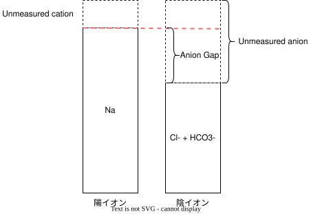
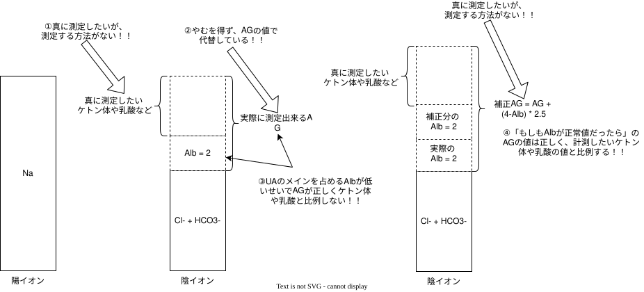

```{=html}
<style>
.reveal .reference {
  color: #666;
  font-size: 0.5em;
  margin-top: 0.7em;
  text-align: right;
}
.reveal .large-table table {
  font-size: 1.0em;
}
.reveal .small-table table {
  font-size: 0.6em;
}
.reveal table {
  font-size: 0.8em;
}
.reveal .small {
  font-size: 0.75em;
}
.reveal .columns {
  gap: 1rem;
}
</style>
```

## Take home message

- 血液ガスは「今の状態(acidemia/alkalemia)」と「ベクトル(alkalosis/acidosis)」を区別する
  - 見た目が正常でも、何が起きているかは分からないと考える
- 「もしも、目に見えるその異常がなかったらどういうガスになる？」というルール = 神様ルール/玉ねぎの皮むきルール
- 特に代謝性の代償を考えるときはTime courseをしっかり考える

# 血液ガスについて

## 血液ガスでわかること

- 主に以下の2つが分かる
  - 酸素化と換気(呼吸の評価)
  - [**酸塩基平衡**]{style="color: red;font-size: 1.2em;"}
- 実はCPAの時に検索する原疾患の4H4Tのうち4Hのかなりを推測可能
  - 低血糖、低/高K血症、Acidosis、低酸素血症

## 動脈血液ガス vs. 静脈血液ガス

::: large-table
| 項目   | 静脈血 − 動脈血              |
|--------|------------------------------|
| pH     | 0.033 \[0.027–0.039\] 低い   |
| pCO₂   | 4.41 \[2.55–6.27\] mmHg 高い |
| HCO₃⁻  | 1.03 \[0.56–1.50\] mmHg 高い |
| 乳酸値 | 2.3 \[1.4–3.2\] mg/dL 高い   |
:::

*Eur J Emerg Med. 2014 Apr;21(2):81–8*

- 基本的には、pHと$HCO3^-$は信じてよい
- $PaO_2$は信じちゃダメ
- 過去にはCO2-は変換式があるといわれたが微妙かも
- 「V gasでCO2/Lactate貯留がなければA gasでも大丈夫だろう」くらいの判断
- DKAの初療とかのGasの異常の解釈が重要な時はA gasを取り直すようにしている

# 酸塩基平衡の基礎

## 酸塩基の代償範囲

::: small-table
+--------------------------+--------------------------------+--------------------------------+--------------------------------------------------------------------------------------------------------------------+-------------------------------+
| 1次性病態                | 1次性変化                      | 代償性変化                     | 代償性変化の範囲                                                                                                   | 代償の限界値                  |
+==========================+================================+================================+====================================================================================================================+===============================+
| **代謝性アシドーシス**   | $[\mathrm{HCO_3^-}]\downarrow$ | $\mathrm{pCO_2}\downarrow$     | $\Delta\mathrm{pCO_2}=1.2\times\Delta[\mathrm{HCO_3^-}]\pm5$<br>$\mathrm{pCO_2}=1.5\times[\mathrm{HCO_3^-}]+8\pm2$ | $\mathrm{pCO_2}:15 mmHg$      |
+--------------------------+--------------------------------+--------------------------------+--------------------------------------------------------------------------------------------------------------------+-------------------------------+
| **代謝性アルカローシス** | $[\mathrm{HCO_3^-}]\uparrow$   | $\mathrm{pCO_2}\uparrow$       | $\Delta\mathrm{pCO_2}=0.7\times\Delta[\mathrm{HCO_3^-}]\pm5$                                                       | $\mathrm{pCO_2}:60mmHg$       |
+--------------------------+--------------------------------+--------------------------------+--------------------------------------------------------------------------------------------------------------------+-------------------------------+
| **呼吸性アシドーシス**   | $\mathrm{pCO_2}\uparrow$       | $[\mathrm{HCO_3^-}]\uparrow$   | 慢性期<br>$\Delta[\mathrm{HCO_3^-}]=0.35\times\Delta\mathrm{pCO_2}\pm3$                                            | $[\mathrm{HCO_3^-}]:42mEq/L$  |
+--------------------------+--------------------------------+--------------------------------+--------------------------------------------------------------------------------------------------------------------+-------------------------------+
| **呼吸性アルカローシス** | $\mathrm{pCO_2}\downarrow$     | $[\mathrm{HCO_3^-}]\downarrow$ | 慢性期<br>$\Delta[\mathrm{HCO_3^-}]=0.40\times\Delta\mathrm{pCO_2}\pm3$                                            | $[\mathrm{HCO_3^-}]:12 mEq/L$ |
+--------------------------+--------------------------------+--------------------------------+--------------------------------------------------------------------------------------------------------------------+-------------------------------+
:::

- 代償反応が十分であれば、高度の酸塩基平衡異常は起こらない
  - pH \<\< 7.2 → 代謝性Acidosis + 呼吸性Acidosisの合併
  - pH \>\> 7.6 → 代謝性Alkalosis + 呼吸性Alkalosisの合併
- とは言え、Septic shockとか著名なDKAなら単独でも起こりうる

## 酸塩基平衡のざっくりとした(厳密には少し違うけど) {#acid-base-map}

```{mermaid}

flowchart TD
    ABG["Acid–Base Disorders"]

    ABG --> MA["代謝性アシドーシス"]
    ABG --> MK["代謝性アルカローシス"]
    ABG --> RA["呼吸性アシドーシス"]
    ABG --> RK["呼吸性アルカローシス "]

    MA --> AGMA["AG開大性代謝性アシドーシス"]
    MA --> NAGMA["AG非開大性代謝性アシドーシス"]


    click AGMA "#/ag-acidosis"
    click NAGMA "#/nag-acidosis"
    click MK "#/metabolic-alkalosis"
    click RA "#/respiratory-acidosis"
    click RK "#/respiratory-alkalosis"
```

------------------------------------------------------------------------

## 酸塩基平衡の考え方

- pHの実際の値がAcidemia/Alkalemia
- そこに持っていく力(ベクトル)がAcidosis/Alkalosis
  - 呼吸性/代謝性に分かれる
- 明らかな時もあるが、打ち消しあって目に見えないこともある

## 例えば

- pH 7.4, HCO3- 24, CO2 40のA gasをみたらどう解釈する？
- 答え1:
  - まったく問題がない健常人のA gas
- 答え2:
  - 呼吸性Acidosisと呼吸性Alkalosisが同時に起きている患者のA gas ...
- 答え4:
  - 呼吸性Acidosisと呼吸性Alkalosisと代謝性acidosisと代謝性alkalosisが同時に起きている患者のA gas

## どうやって区別する？

- 明らかな異常がある場合、「それがなかったら……」という風に考える

::: {style="color: red; font-size: 1.2em;"}
- **目の前の、酸塩基の異常を魔法で消し去ったらどうなる？**
:::

- 代表的なのが

  - 代償
  - Alb補正
  - 補正HCO3-

- まずは、AG開大代謝性Acidosisで考えてみましょう

## AG開大性代謝性 アシドーシス {#ag-acidosis}

::: large-table
+-------------------------------------+------------------------------+
| GOLDMARK                            | KUSSMAUL                     |
+=====================================+==============================+
| Glycols(Ethylene and propylene)     | Ketoacidosis                 |
+-------------------------------------+------------------------------+
| Oxoproline                          | Uremia                       |
+-------------------------------------+------------------------------+
| L-lactate                           | Salicylate poisoning         |
+-------------------------------------+------------------------------+
| D-lactate                           | Methanol                     |
+-------------------------------------+------------------------------+
| Methanol                            | Aldehyde                     |
+-------------------------------------+------------------------------+
| Aspirin                             | Lactic acidosis              |
+-------------------------------------+------------------------------+
| Renal failure                       | Ethylene glycol              |
+-------------------------------------+------------------------------+
| Ketoacidosis                        |                              |
+-------------------------------------+------------------------------+
:::

: AG開大性代謝性アシドーシスの鑑別[@Mehta2008-mi]

$$Anion Gap = Na^+ - (Cl^- + HCO_3^-)$$

- 通常はAGが開大(12以上)だと以下の項目を鑑別(GOLDMARK, KUSSMAUL)

- Anion Gapの式は上記だが、名前のごとく"陰イオンのGap(差)"が本質

  - 正確にはUnmeasured anion(測定されない分の陰イオン)

- 未測定陰イオン - 未測定陽イオン = AG

[← Acid–Base Map](#/acid-base-map)

------------------------------------------------------------------------

## Anion gapが変化する要因

+--------------+------------------------+--------------+-------------------------------------------+
| AG上昇：原因 | AG上昇：例             | AG低下：原因 | AG低下：例                                |
+==============+========================+==============+===========================================+
| **UCの減少** | - 低γグロブリン血症    | **UCの増加** | - 高γグロブリン血症(多発性骨髄腫、膠原病) |
|              |                        |              |                                           |
|              | - 低K、Ca、Mg血症      |              | - 高K、Ca、Mg血症                         |
|              |                        |              |                                           |
|              |                        |              | - リチウム中毒                            |
+--------------+------------------------+--------------+-------------------------------------------+
| **UAの増加** | - 乳酸アシドーシス     | **UAの減少** | - **低アルブミン血症**                    |
|              |                        |              |                                           |
|              | - ケトアシドーシス     |              |                                           |
|              |                        |              |                                           |
|              | - 尿毒症、高P血症      |              |                                           |
|              |                        |              |                                           |
|              | - HHS                  |              |                                           |
|              |                        |              |                                           |
|              | - 横紋筋融解症         |              |                                           |
|              |                        |              |                                           |
|              | - ペニシリン系抗菌薬   |              |                                           |
|              |                        |              |                                           |
|              | - トルエン、サリチル酸 |              |                                           |
+--------------+------------------------+--------------+-------------------------------------------+

- AG開大の真に意味する事は？

## AGの真に意味すること

{fig-align="center"}

- Unmeasured anion(UA)の増加あるいはUnmeasured cation(UC)の減少
  - UCの減少によるAG開大性代謝性アシドーシスほぼ起こらない
- そのため、基本はUAの増加によるもの
- UAって何ですか？

## Unmeasured anionとは

+--------------------------+--------------------------+
| 測定されていない陰イオン | 測定されていない陽イオン |
+==========================+==========================+
| - **Alb(15 mEq/L)**      | - Ca(5 mEq/L)            |
|                          |                          |
| - 有機酸(5 mEq/L)        | - K(4.5 mEq/L)           |
|                          |                          |
| - リン酸塩(2 mEq/L)      | - Mg (1.5 mEq/L)         |
|                          |                          |
| - 硫酸塩(1 mEq/L)        | = 11 mEq/L               |
|                          |                          |
| = 23 mEq/L               |                          |
+--------------------------+--------------------------+

: AGの寄与因子[@Marino2026ICU]

- UAのほとんどはAlbでできている

- そのため、低Alb血症の時に補正が必要

## 低Alb血症の補正の考え方



- Alb 2g/dLの患者のAGが11 mEq/Lだったら・・・・・・

- 魔法使い: 「今から、この患者のAlbを 4g/dLに直してあげよう」

- そうすると、AGはどうなる？ → UAが増えるのだから、その分AGは開大する！

- 補正の式は補正AG = AG + (4 - 血清Alb) \* 2.5

## 補正HCO3-の考え方

- AG開大している = 異常物質(UA)が増えている = 代謝性Acidosisが起きている = HCO3-はUAの分見た目上減っている

- AGが開大していたら、HCO3-やCO2が正常でも少なくとも1種類の異常(AG開大性代謝性Acidosis)が起きている！

- なら、このUAを消したらどうなる？

- AGのGapの分が減ると、その分HCO3-が増加する

- 補正HCO3- = (AG - 12) + HCO3-

  - 22 mEq/L以下でAG非開大性代謝性Aidosisの合併、26 mEq/L以上で代謝性Alkalosisの合併

## 浸透圧Gap

- 「AG開大しているのにLactateやケトン体が陰性」の時に毒物の存在を疑うきっかけとなる指標

  $$Osm_{gap} = Serum_{osm} - 2 * [Na] + BUN/2.8 + Glu/18 $$

- 10-15 mOsm/L以上の場合に毒物の存在を疑う

- ケトン体の場合はどれくらいがDisproportionalかは分からないのが難点・・・・・・

## ここまでのまとめ

- AGとはUA - UCであり、UAのメインの成分はAlb

- AGが開大していたら、**絶対に**AG開大性代謝性Acidosisはある

  - AGの開大は常に探したほうが良い

- 「もしもこの患者に低Albがなかったら？」→補正AG

- 「もしもこの患者にUAの貯留がなかったら？」→補正HCO3-

## Normal Anion Gap 代謝性 アシドーシス {#nag-acidosis}

- 「測定されるAnionの異常」
  - 具体的にはHCO3-の喪失かClの負荷(Normal salineの負荷)
- 腎臓がアンモニウムイオンの排泄を介して調整をしているため、そこから鑑別をつける

$尿AG = 尿中Na^+ + 尿中K^+ - 尿中Cl^- = 80 - 尿中NH4^+$

- 腎臓が**原因でなければ**、尿中のNH4+が増加→Urine AGは負の値となる

- 血中AGのイメージだと、Unmeasured cationがNH4+と考えると良い

  - そのため、尿中のUnmeasured anion(Alb)が増えるトルエン中毒では見た目上AGが低値

- 実際は実臨床で覚える鑑別は2種類

  - 下痢(腸液のHCO3-の排泄による代謝性Acidosis)
  - [**尿細管Acidosis**]{style="color: red; font-size: 1.1em;"}

[← Acid–Base Map](#/acid-base-map)

## 尿細管Acidosis

- 4種類に分かれるが、実際は3種類のみ
- 遠位尿細管で起こるI型RTA
- 近位尿細管で起こるII型RTA
- Aldosterone内服した状態のIII型RTA
- まずは薬 → 膠原病という風に考える

## 尿細管Acidosis

- I型RTAの方が遠位のため代償が聞かず尿のpHが高い(アルカリ)

  - I型RTAでは尿pH\>5.5, 尿中Na \> 25

- II型RTAは近位尿細管の再吸収が聞かないため、色んなものが抜ける

## Type I RTA(distal)

+----------------------+-------------------------------------------------------------------------+
| 分類                 | 疾患名                                                                  |
+======================+=========================================================================+
| Primary              | 家族性                                                                  |
+----------------------+-------------------------------------------------------------------------+
| 薬剤                 | Amphotericin B, Lithium, Ibuprofen                                      |
+----------------------+-------------------------------------------------------------------------+
| 自己免疫性疾患       | **SJD**, AIH/PBC, SLE, RA, Hashimoto thyroiditis, PAN, Cryoglobulinemia |
+----------------------+-------------------------------------------------------------------------+
| 高Ca尿症状となる疾患 | 副甲状腺機能亢進症, FHH, Vitamin D中毒, Sarcoidosis                     |
+----------------------+-------------------------------------------------------------------------+
| 腎疾患               | 尿閉解除後, AIN                                                         |
+----------------------+-------------------------------------------------------------------------+

[@emmett2025rta]

- 尿路結石や腎へのCa沈着が多い


## Type II RTA(proximal)

| 分類 | 疾患名 |
|----|----|
| 家族性 | Fanconi症候群 |
| 薬剤 | Tenofovir等の抗ウィルス薬, Acetazolamide, Topiramate, Aminoglycoside, プラチナ系抗癌剤, Valproate |
| 自己免疫性疾患 | SJD(通常はType I) |
| **M蛋白血症** | Amyloidosis、MM/軽鎖病 |
| 重金属 | 鉛, Cadmium, 水銀, 銅 |
| その他 | Vitamin D欠乏 |

[@dynamed2026rta]

- 尿路結石や腎へのCa沈着は多くない


## Type IV RTA

- 最も多いのは保存期CKD
- その他だと糖尿病性腎症による低レニン高アルドステロン症や間質性腎炎が多い

| 分類 | 疾患名 |
|----|----|
| 家族性 |  |
| 薬剤 | ACEi/ARB/MRA, NSAIDs, MRA, BB, Calcineurin阻害薬, Heparin |
| Mineralcorticoid欠乏症 | Addison病、DM、AIDS、TIN、IgM monoclonal gammopathy |
| Mineralcorticoid耐性 | Amyloidosis、糖尿病性腎症, Lupus腎症 |

## RTAの比較

## 尿細管性アシドーシスの類型の特徴と鑑別点

|  | 近位 RTA | 遠位 RTA | Type 4 RTA |
|---|---|---|---|
| **病態** | 近位尿細管での<br>HCO₃⁻ 再吸収障害 | 遠位・集合管での<br>尿酸性化障害 | アルドステロン<br>作用障害 |
| **成人での主要な原因疾患** | Fanconi 症候群<br>パラプロテイン血症（LCPT など） | Sjögren 症候群<br>関節リウマチ、SLE<br>原発性胆汁性肝硬変 | 保存期 CKD、糖尿病、SLE |
| **原因となる主要な薬剤** | アセタゾラミド<br>プラチナ系抗癌薬<br>イホスファミド<br>アミノグリコシド<br>バルプロ酸・ゾニサミド<br>重金属（鉛・カドミウム） | ST 合剤・ペンタミジン<br>アムホテリシン B<br>リチウム<br>トピラマート<br>（トルエン[^2]） | カルシニューリン阻害薬<br>RAAS 阻害薬<br>ヘパリン・ナファモスタット |
| **成人での主要な症候<br>（遺伝性以外）** | Fanconi 症候群<br>（尿糖・低尿酸血症・尿細管障害） | 腎石灰化・腎尿路結石<br>高 Ca 尿症・低クエン酸尿症 | 特異的なものはなし |
| **腎石灰化・結石** | 時々<br>リン酸 Ca 結石 | 多い<br>リン酸 Ca 結石 | しばしば<br>シュウ酸 Ca 結石 ＞ 尿酸結石 |
| **血清 K 値** | 低値 | 低値 | 高値 |
| **血清 HCO₃⁻ 値** | 15 mEq/L 未満は稀 | 15 mEq/L 未満となりうる | 大抵 ＞15 mEq/L |
| **尿 pH** | 高度アシデミアで<br>低値（<6）を取りうる | 常に高値（≥6.5） | 大抵低値（<6.0） |
| **尿 AG** | 腎障害が軽度であれば負 | 正 | 正 |
| **アシデミア是正に必要な HCO₃⁻ 量** | 10〜15 mEq/kg/日<br>（多量に必要） | 1〜2 mEq/kg/日 | 1 mEq/kg/日 |
| **成人での薬物治療** | 症状や合併症なければ<br>必ずしも必要なし | 急性期：KCl にて低 K を先に是正後、アルカリ投与<br>慢性期：クエン酸 K | 重曹<br>フロリネフ（0.1〜0.2 mg/日） |
| **食事指導<br>（慢性期）** | アルカリ食（野菜・果物） | 結石予防<br>（塩分・シュウ酸・果糖・動物蛋白制限） | K 制限 |

[^1]: 確定診断と言われる酸負荷（NH₄Cl）やフロセミド・フルドロコルチゾンによる尿酸性化能評価は診断能が高くなく、尿ガス測定や試薬が利用できないことが多いため、実臨床では非実用的である。

[^2]: トルエンは dRTA と同様の臨床所見を呈するが、尿酸性化障害とは別機序で生じる。

------------------------------------------------------------------------


## 代謝性 アルカローシス {#metabolic-alkalosis}

- 正直あまり問題にならない事が多い
- 一応、発生因子と維持因子を分けて考える必要がある
  - 発生因子
    - Cl-塩の喪失: 下痢、嘔吐、利尿薬、MRA亢進(しばしば脱水)
    - Kの欠乏
    - 塩基負荷: 重曹、グルコン酸塩、クエン酸など
  - 維持因子
    - 発生因子の持続
    - HCO3-濾過の低下: 脱水によるRAA系の亢進
    - HCO3-再吸収の増加

## 代謝性アルカローシスの原因の大雑把な考えと検索

- 大きく分けて以下の3つ
  - アルカリの負荷: 薬剤性
  - 酸の喪失(H, Cl): 腎臓 vs. 腎臓外でのCl
    - 腎MR活性亢進および尿細管のCl再吸収阻害(利尿薬)
  - 脱水: RAA系亢進→Angiotensin IIによりHCO3-吸収亢進など

[@takagishi2024flowchart]
- 原因検索はまずは病歴で、嘔吐・胃管吸引・利尿薬を確認
- それで分からない時は**尿中Cl**を計測する
  - 尿中Cl \< 10-25 mEq/Lの場合は腎臓以外のCl喪失: 嘔吐などの胃液の喪失、Cl喪失性の下痢
  - 尿中Cl > 20-40 mEq/Lの場合は腎臓からのCl喪失: Barter/Gitelman症候群、RAA系の亢進、Steroid、利尿薬、低Mg血症など


[← Acid–Base Map](#/acid-base-map)


------------------------------------------------------------------------

## 呼吸性 アシドーシス {#respiratory-acidosis}

<!-- Todo: 確認 -->
- いわゆる肺胞低換気 = II型呼吸不全
- 物理的に肺胞に空気が入らない状態
- 解剖学的に考えるのが良い
  - 脳: 重度の意識障害の他に、CO2 Narcosis
  - 中枢神経/胸郭/筋肉: Guillan-Barre syndromeなどの神経筋疾患の他に呼吸筋疲労や結核後遺症や重度の胸郭変形も
  - 上気道: Stridorが出る疾患、簡単に言うと窒息
  - 下気道: Wheezeが出る疾患、心不全/Asthma/COPDなど
- HCO3-が代償していたら慢性的なものを疑う

[← Acid–Base Map](#/acid-base-map)

------------------------------------------------------------------------

## 呼吸性アルカローシス {#respiratory-alkalosis}

<!-- Todo: 確認 -->
- 過換気が原因
- 正直、一番多いのは肺炎とか心不全とかの全身状態悪化に伴う過換気
- 後は代謝性Acidosis(特にDKA)に対する代償
  - Kussmaul呼吸

[← Acid–Base Map](#/acid-base-map)

## Re mindmap

```{mermaid}
%%| fig-width: 10
%%| fig-height: 6

flowchart TD
    ABG["Acid–Base Disorders"]

    ABG --> AlbCorrectAG["Alb補正の上でのAG計算"]

    AlbCorrectAG --> AlbCorrectAGPosi["AG \> 12"]
    AlbCorrectAG --> AlbCorrectAGNega["AG \< 12"]

    AlbCorrectAGPosi --> AG["AG開大性代謝性Acidosis"]
    AG --> HCO3["補正HCO3-を計算する"]
    HCO3 --> HCO3eval["AG開大性代謝性Acidosisや代謝性アルカローシスの合併を計算"]

    

    HCO3eval --> Othereval["その他の一次性のAcidosis/Alkalosisを評価"]

    AlbCorrectAGNega --> Othereval["その他の一次性のAcidosis/Alkalosisを評価"]

    Othereval --> Secondaryeval["代償変化を評価し隠れたAcidosis/Alkalosisを評価"]


    
```

## References {.scrollable}

::: {#refs}
:::