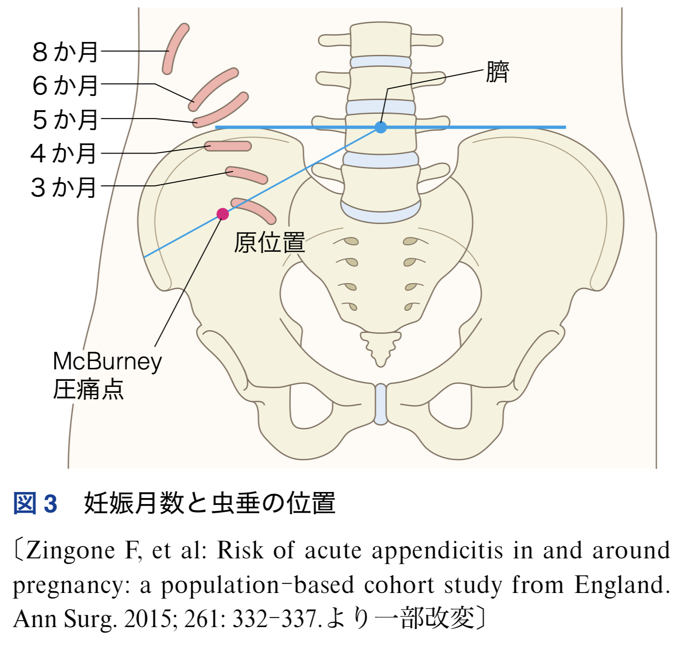
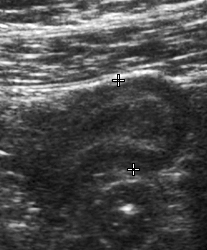

```{css}
<style>
/* スライド幅の 1/2 */
.half-table {
  width: 50%;
}

.half-table table {
  width: 100%;
}

/* スライド幅の 1/4 */
.quad-table {
  width: 25%;
}

.quad-table table {
  width: 100%;
}

/* 中央寄せしたい場合 */
.center-table {
  margin-left: auto;
  margin-right: auto;
}

/* 左寄せしたい場合 */
.left-table {
  margin-left: 0;
  margin-right: auto;
}

/* 表を少しコンパクトに */
.compact-table table {
  font-size: 0.75em;
}

.compact-table th,
.compact-table td {
  padding: 0.25em 0.45em;
  line-height: 1.1;
}
</style>
```

# ER診療について

## 妊婦の特徴

- 若年女性が多い
  - いわゆる高齢者がかかる疾患にはかからない
- 妊娠により、種々の変化が起こる
  - 身体所見(特に腹痛で)が大きく変わる
  - Vital signや採血結果の正常値が変わる
- 一方で、造影剤や放射線などの検査の限界が多い
- さらに使える薬剤も限定される → (少なくとも自分は)苦手意識がある

# 正常妊娠概論

## 妊娠の時期と意味

- 妊娠前の最終月経が始まった日を0週0日と数える
  - 1st trimester: 0w0d ~ 13w6d
  - 2nd trimester: 14w0d ~ 27w6d
  - 3rd trimester: 28w0d ~ 
- 薬剤の場合は以下で考える
  - 受精前～妊娠3週末まで: 先天異常出現率は増加しない: all or none
  - 4-7週: 器官形成期で薬剤感受性が高い
  - 8-12週末まで: 大奇形は起こさないが小奇形を起こしうる医薬品はわずかにある(口蓋や性器など)
  - 13週～: 奇形は基本起こさない。胎児毒性を引き起こす可能性がある薬品がわずかにある[@jsog2020obstetric]
- 3-5%は先天異常、15%は流産

-放射線の場合は以下の通り
  - 受精後10日までの被曝で奇形発生率の上昇はない
  - 受精後11日～妊娠10週までの被曝で奇形誘発の可能性はあるが50 mGy未満では奇形発生率は上昇しない
  - 妊娠9-26週では中枢神経障害を起こす可能性があるが、100 mGy未満では影響しない

## 妊娠の時期による影響

| 系統 | 項目 | 変化 |
|------------------------|------------------------|------------------------|
| **循環** | 末梢血管抵抗 | ↓ |
|  | 血圧 | 16〜24週 ↓，その後 →〜↗ |
|  | 循環血液量 | ↑ 40〜50% |
| **腎機能** | 血清クレアチニン | ↓（正常平均 0.5 mg/dL, 上限 0.7 mg/dL） |
| 血液関連 | Hct/Hgb | ↓（35%未満）/ ↓（～10.5 g/dL） |
|  | 白血球数 | ↑（〜15,000，特に分娩時 ↑） |
|  | 血小板数 | ↓ |
|  | 凝固能 | ↑ |
| **呼吸機能** |  | 生理的過換気 |
| **糖代謝** | 生理的インスリン抵抗性 | ↑ |
| **甲状腺機能** | 妊娠初期：hCGの影響 | ↗ |
|  | 妊娠中期〜後期 | ↘ |
| **腸管機能** |  | ↓ |

妊娠による影響


# 妊婦への放射線検査

## 妊婦への放射線検査概論

- チェルノブイリのデータか原子爆弾のデータがメイン
- 受精後10日までの被曝では胎児奇形の発生率上昇はない(50-100mGy)
  - All or noneの時期
- 11日～10週までの胎児被曝では奇形誘発をする可能性があるが50mGyまでは安全
- 9-26週までは中枢神経障害を起こす可能性があるが、100mGyまでは安全とされる
  - ACOGだと、8-15週は60-310mGy, 16週以降は250-280mGyで知的障害が起こりうるとされる
[@jsog2020obstetric;@ACOG2017DiagnosticImagingPregnancy]


## 放射線検査による被曝量

| 検査方法     | 部位   | 平均被ばく線量（mGy） | 最大被ばく線量（mGy） |
|--------------|--------|----------------------:|----------------------:|
| **単純撮影** | 頭部   |              0.01以下 |              0.01以下 |
|              | 胸部   |              0.01以下 |              0.01以下 |
|              | 腹部   |                   1.4 |                   4.2 |
|              | 腰椎   |                   1.7 |                    10 |
|              | 骨盤部 |                   1.1 |                     4 |
| **CT検査**   | 頭部   |             0.005以下 |             0.005以下 |
|              | 胸部   |                  0.06 |                  0.96 |
|              | 腹部   |                     8 |                    49 |
|              | 腰椎   |                   2.4 |                   8.6 |
|              | 骨盤部 |                    25 |                    79 |

## 放射線被ばく量にソートした検査

| 検査の種類 | 胎児線量（mGy）[^fetal-dose] |
|:---|---:|
| **極低線量の検査（<0.1 mGy）** | |
| 　頸椎X線撮影（AP・側面像） | <0.001 |
| 　頭部or頸部CT | 0.001–0.01 |
| 　四肢のX線撮影 | <0.001 |
| 　マンモグラフィ（2方向） | 0.001–0.01 |
| 　胸部X線撮影（2方向） | 0.0005–0.01 |
| **低～中等度線量の検査（0.1–10 mGy）** | |
| 　**X線撮影・造影検査** | |
| 　　腹部X線撮影 | 0.1–3.0 |
| 　　腰椎X線撮影 | 1.0–10 |
| 　　静脈性腎盂造影 | 5–10 |
| 　　二重造影バリウム注腸検査 | 1.0–20 |
| 　**CT** | |
| 　　胸部CTまたはCT肺動脈造影 | 0.01–0.66 |
| 　　撮影範囲を限定したCT骨盤計測（大腿骨頭を通る横断像1断面） | <1 |
| 　**核医学検査** | |
| 　　低線量肺血流シンチグラフィ | 0.1–0.5 |
| 　　テクネチウム99m骨シンチグラフィ | 4–5 |
| 　肺動脈の血管造影(DSA) | 0.5 |
| **高線量の検査（10–50 mGy）** | |
| 　腹部CT | 1.3–35 |
| 　骨盤CT | 10–50 |
| 　フッ素18標識FDGを用いた全身PET/CT | 10–50 |

: 一般的な放射線画像検査における胎児線量 {#tbl-fetal-radiation-doses}

[@ACOG2017DiagnosticImagingPregnancy]

## 妊婦への検査～Ｘ線

- ほとんどの場合は問題にならない
- 一応、胸部X線をとる時は腹部を覆う
- 東京からNYに行くと約0.11- 0.16 mGy(胸部X線の2枚分くらい)
- 年間の自然被曝は2.1-2.4 mGy[@env_radiation_2015]

## 妊婦への検査～CT検査


- 通常のCT検査はよほどの事がない限り胎児毒性が出る被曝量にはならないため、**必要ならやる**
  - 例えば、虫垂炎、腸閉塞を疑ったときはやるべきと明記されている[@ACOG2017DiagnosticImagingPregnancy]
- PE条件も胎児への被曝量は少なくなる

## 造影CTでのヨード造影剤は？

- ヨード造影剤は胎盤を超えて胎児循環には入るが、特に催奇形性はないとされる[@ACOG2017DiagnosticImagingPregnancy]
- 理論上の甲状腺機能亢進になるRiskも、水溶性のヨード造影剤だと大丈夫らしい[@ACR2026ContrastMedia]
- とは言え、必要な時にだけ使う(大体妊婦にCTするときは必要な時な気もするが)

## 妊婦への検査～MRI検査

- 安全に可能
- ただし、Gd造影剤は基本的に禁忌
- 当院では結局使わないと思う

## 当院では？

- 2026/10に確認したところ、理論上は可能(数年前に腹部MRI検査をやった事はあると)
  - ただし、休日夜間は不可能
  - また腹部MRIの虫垂炎の読影は制度が落ちる
- 「本当に疑うなら造影CT撮像してください」との事
- 特別なプロトコルはないとの事で「造影のみで」くらいで良いらしい

# 妊婦への治療

## 妊娠の時期による影響～薬剤の影響

- 薬剤や放射線の場合は以下で考える
  - 受精前～妊娠3週末まで: 先天異常出現率は増加しない: all or none
  - 4-7週: 器官形成期で薬剤感受性が高い
  - 8-12週末まで: 大奇形は起こさないが小奇形を起こしうる医薬品はわずかにある(口蓋や性器など)
  - 13週～: 奇形は基本起こさない。胎児毒性を引き起こす可能性がある薬品がわずかにある[@jsog2020obstetric]

- 薬で困ったら患者に妊娠と薬のHPを教えても良い[@ncchd_kusuri]

## 妊娠初期

| 一般名または医薬品群名 | 代表的商品名 | 報告された催奇形性・胎児毒性 |
|------------------------|------------------------|------------------------|
| カルバマゼピン | テグレトール，他 | 催奇形性 |
| シクロホスファミド | エンドキサン | 催奇形性 |
| ダナゾール | ボンゾール，他 | 催奇形性：女児外性器の男性化 |
| チアマゾール | メルカゾール | 催奇形性：MMI奇形症候群 |
| バルプロ酸ナトリウム | デパケン、セレニカR，他 | 催奇形性：二分脊椎、胎児バルプロ酸症候群 |
| ビタミンA（大量） | チョコラA，他 | 催奇形性 |
| フェニトイン | アレビアチン、ヒダントール，他 | 催奇形性：胎児ヒダントイン症候群 |
| フェノバルビタール | フェノバール，他 | 催奇形性：口唇・口蓋裂，他 |
| ミコフェノール酸モフェチル | セルセプト | 催奇形性：外耳・顔面奇形、口唇・口蓋裂、遠位四肢・心臓・食道・腎臓の奇形，他／流産 |
| ミソプロストール | サイトテック | メビウス症候群、四肢切断、子宮収縮、流産 |
| メトトレキサート | リウマトレックス，他 | 催奇形性：メトトレキサート胎芽病 |
| ワルファリンカリウム（クマリン系抗凝血薬） | ワーファリン，他 | 催奇形性：ワルファリン胎芽病、点状軟骨異栄養症、中枢神経異常 |

## 妊娠中・後期

| 一般名または医薬品群名 | 代表的商品名 | 報告された催奇形性・胎児毒性 |
|------------------------|------------------------|------------------------|
| アミノグリコシド系抗結核薬 | カナマイシン注、ストレプトマイシン注 | 胎児毒性：非可逆的第VIII脳神経障害、先天性聴力障害 |
| アンジオテンシン変換酵素阻害薬（ACE-I） | カプトプリル、レニベース，他 | 胎児毒性：胎児腎障害・無尿・羊水過少、肺低形成、Potter sequence |
| アンジオテンシンII受容体拮抗薬（ARB） | ニューロタン、バルサルタン，他 | 胎児毒性：胎児腎障害・無尿・羊水過少、肺低形成、Potter sequence |
| テトラサイクリン系抗菌薬 | アクロマイシン、レダマイシン、ミノマイシン，他 | 胎児毒性：歯牙の着色、エナメル質形成不全 |
| ミソプロストール | サイトテック | 子宮収縮、流早産 |

## 妊娠後期

| 一般名または医薬品群名 | 代表的商品名 | 報告された催奇形性・胎児毒性 |
|------------------------|------------------------|------------------------|
| アミノグリコシド系抗結核薬 | カナマイシン注、ストレプトマイシン注 | 胎児毒性：非可逆的第VIII脳神経障害、先天性聴力障害 |
| アンジオテンシン変換酵素阻害薬（ACE-I） | カプトプリル、レニベース，他 | 胎児毒性：胎児腎障害・無尿・羊水過少、肺低形成、Potter sequence |
| アンジオテンシンII受容体拮抗薬（ARB） | ニューロタン、バルサルタン，他 | 胎児毒性：胎児腎障害・無尿・羊水過少、肺低形成、Potter sequence |
| テトラサイクリン系抗菌薬 | アクロマイシン、レダマイシン、ミノマイシン，他 | 胎児毒性：歯牙の着色、エナメル質形成不全 |
| ミソプロストール | サイトテック | 子宮収縮、流早産 |
| 非ステロイド系抗炎症薬（NSAIDs）（インドメタシン、ジクロフェナクナトリウム，他） | インダシン、ボルタレン，他 | 胎児毒性：動脈管収縮、胎児循環遷延、羊水過少、新生児壊死性腸炎 |

## 妊娠初期にのみ使用されたときに問題がない薬

| 医薬品＜一般名＞ | 分類 |
|:---|:---|
| イトラコナゾール、ミコナゾール | 抗真菌薬 |
| オフロキサシン、シプロフロキサシン、スパルフロキサシン、トスフロキサシントシル酸塩、ノルフロキサシン、レボフロキサシン、ロメフロキサシン塩酸塩 | ニューキノロン系抗菌薬 |
| ニフェジピン（妊娠20週未満）、ニカルジピン塩酸塩（経口錠）、アムロジピンベシル酸塩 | カルシウム拮抗薬 |
| ヒドロキシジン塩酸塩 | 抗ヒスタミン薬 |
| オキサトミド、トラニラスト、ペミロラストカリウム | 抗アレルギー薬 |
| 風疹ワクチン、水痘ワクチン、流行性耳下腺炎ワクチン、麻疹ワクチン | 生ワクチン |
| センナ、センノシド | 緩下薬 |
| ハロペリドール、ブロムペリドール（ただしこれらは、妊娠末期では新生児錐体症候群のリスクとなる） | ブチロフェノン系抗精神病薬 |
| メトホルミン塩酸塩、グリベンクラミド | 経口血糖降下薬 |
| ドンペリドン | 制吐薬 |
| 卵胞ホルモン、黄体ホルモン、低用量ピル | 女性ホルモン薬 |
| クロミフェンクエン酸塩 | 排卵誘発薬 |
| ニコチン置換療法薬 | 禁煙補助薬 |
| エチドロン酸二ナトリウム、ミノドロン酸水和物、リセドロン酸ナトリウム | ビスフォスフォネート製剤 |
| インドメタシン、ジクロフェナクナトリウム、スリンダク、メロキシカム（ただしこれらは、妊娠末期では胎児毒性を示す） | 非ステロイド系抗炎症薬 |
| アンジオテンシン変換酵素阻害薬（ACE-I）、アンジオテンシンII受容体拮抗薬（ARB）（ただしこれらは、妊娠中期以降では胎児毒性を示す） | 降圧薬 |

: 添付文書上いわゆる禁忌*の医薬品のうち、妊娠初期のみに使用された場合、臨床的に有意な胎児への影響はないと判断してよい医薬品 {#tbl-pregnancy-drugs}

## どの薬が使える？

| 分類 | 薬剤系統 | 妊娠中の使用に関して |
|------------------------|------------------------|------------------------|
| **主な抗菌薬** | ペニシリン系/セフェム系 | 個々の薬剤についての情報は限られているが、妊娠初期の使用により先天異常発生リスクは上昇しないと考えられる。 |
|  | アミノグリコシド系 | ゲンタマイシンやストレプトマイシンでは妊娠初期の使用により先天異常発生リスクは大きく上昇しないと報告されている。妊娠期の使用により、聴覚障害の影響が報告されている。 |
|  | マクロライド系 | アジスロマイシン、エリスロマイシン、クラリスロマイシンでは妊娠初期の使用により先天異常の発生リスクは大きく上昇しないと報告されている。エリスロマイシンの新生児への直接投与により幽門狭窄の報告があるが、妊娠中の使用による影響についてはいくつかの報告で否定されている。 |
|  | テトラサイクリン系 | テトラサイクリンでは、妊娠初期の使用により先天異常発生リスクは大きく上昇しないと報告されている。歯牙の石灰化が始まる時期（妊娠4〜5カ月以降）の使用では歯牙の着色が起こる可能性がある。 |
|  | ニューキノロン系 | キノロン系薬剤の妊娠初期の使用により先天異常発生リスクは大きく上昇しないと報告されている。 |
| **主な解熱鎮痛薬** | アセトアミノフェン | 妊娠初期の使用により先天異常発生リスクは大きく上昇しないと報告されている。 |
|  | NSAIDs | 妊娠初期の使用により先天異常発生リスクは大きく上昇しないと報告されている。妊娠後期の使用により胎児の動脈管の早期閉鎖が起こり、出生後に遷延性肺高血圧症や動脈管開存症が起こる可能性がある。 |

抗菌薬と解熱剤

# Communicationの仕方

## 放射線検査ないし薬物治療をする時の心得

- 基本的に妊婦は**心配している**
  - お腹の赤ちゃんに何かあった時に自分のせいじゃないか？と思ってしまう
- 事実として、全ての妊娠の3-5%は先天異常、15%は流産の事を伝える
- 「絶対に安全」とは言えないが、「現状なら使った方が良い」とか「使わなくても良い」とかを教えている
- Ex\) 
「人体実験ができない以上、どんな薬も絶対に安全だという事は絶対には言えないです。ただし、このカロナールという薬は今までの歴史で多くの妊婦さんに使われてきて問題がなかったことが証明されている薬です」
「必要がなければ飲まなくても良い薬ですが、どうしても熱が苦しかったり痛かったら飲んでも良いと思います」
「今、あなたはおしっこにばい菌がいるので抗菌薬が必要です。抗菌薬も、**絶対に安全という事は難しい**のですが、その上であなたの場合は**飲まない事が圧倒的に飲むことより赤ちゃんにも不利益が出ます。絶対に飲み切ってください**。今までの歴史で安全性が高いものをお出ししますのでご安心ください」
- 咳止めとか、痰切りとかは上記のテンションで話して飲むかどうか相談している(大体飲まない人が多い)


## 授乳婦への説明

- 基本的に母親が使っている医薬品が児に影響することは少ない
  - 母乳を介しての薬剤曝露は通常子宮内に比べて1%未満~10%程度
- X線被曝と授乳は関係ない
- ヨード造影剤後は古典的には24時間授乳を待つように言われていたが、特に不要らしい(すぐあげてOK)[@ACOG2017DiagnosticImagingPregnancy]

# 特に知っておくべき妊婦の疾患

## 無症候性膿尿/細菌尿

<!-- Todo：調べる -->

- 腎盂腎炎、早産が増えるため、基本的には治療対象
- 2015年のRCTでは治療効果がないというのもあるが・・・・・・

## 腹痛

- まずは、産科的緊急疾患

<!-- Todo：調べる -->
- 時期との関連

  - 異所性妊娠

  - 常位胎盤早期剝離

  - 切迫早産など

- まぁ、ここら辺はさすがに産科に行くと思うが・・・・・・

- 気を付けるのは虫垂炎の疼痛部位が移動する事(後述)

# Case study

## 急性腹症の患者 {.case}

- 26歳女性、妊娠32週

- 1日前から徐々に増悪する右下腹部痛の患者

- Bedside echoで虫垂炎はよくわからない

## 妊婦の急性腹症

- 全妊婦の中で非産科関連の急性腹症は0.5-2%で起こる
- 妊娠中は実は虫垂炎の発症率は非妊婦に比べて低い(35%ほど下がる)[@Zingone2015-tt]が、妊娠中の急性腹症の中では最多(約25%)[@dynamedAbdominalPainPregnancy]
  - 1st~2nd trimesterが多く3rd trimesterではそこまで多くない

## 妊婦の虫垂炎疑い



[@jaam2023ultrasound]

- 実際は、右下腹部が痛い妊婦が大多数(80%)[@dynamedAbdominalPainPregnancy]
- ただし、3rd trimesterだと右上に痛みが出ることがある
  - 反跳痛や板状硬も出にくい
  - WBCも自然に上昇しているため診断が難しい
- 診断はUS → 単純MRI → 造影CT[@rebarber2026appendicitis]

<!-- Todo：Tabにする -->
## 超音波


[@rebarber2026appendicitis]

- 感度 0.72 (95% CI 0.45-0.92) / 特異度 0.95 (95% CI 0.84-0.99)
- 見えなかったときに除外は出来ない

## 単純MRI
感度 96.8% (95% CI 89-99.6)/ 特異度 99.2% (95% CI 98.2-99.8)[@rebarber2026appendicitis]

## 造影CT

- UptoDateによると、プロトコルを変えれば胎児被曝を3mGy未満に出来る(一般的なプロトコルだと20-40mGy)
- 感度0.99 (95% CI 0.96-1.00) / 特異度 0.91 (0.75-0.97)[@rebarber2026appendicitis]

## 気管支喘息の患者 {.case}

- 30歳女性、妊娠20週

- 元々気管支喘息を指摘されていた。3日前の感冒をきっかけにWheezeがあり来院、SpO2 90％(RA)

## 妊婦の気管支喘息
<!-- Todo：調べる -->

- Systemic corticosteroid、使えるICS/LABA、ICSだけの方がいい？
- ICS/LABAによる胎児の身長の影響など
- Communicationをする

## 胸痛の患者 {.case}

- 41歳女性、妊娠30週
- 右下肢の腫脹と痛みがあり来院
- D-dimerは2.0

## DVT/PEを疑う患者

<!-- Todo：調べる -->
- YEARS criteriaを使う
- 必要があれば、造影CTはしちゃって良い(被曝量は少ない)
- 治療はHeparin

DVT: 5000U → 10000-15000 U/day
PE: UFH 5000U → 31200 U/day

正直、PEは多すぎる気はする


## Thank you for your listening!!

## Reference

::: {#refs}
:::