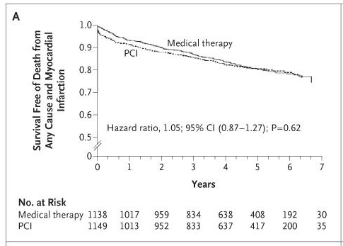
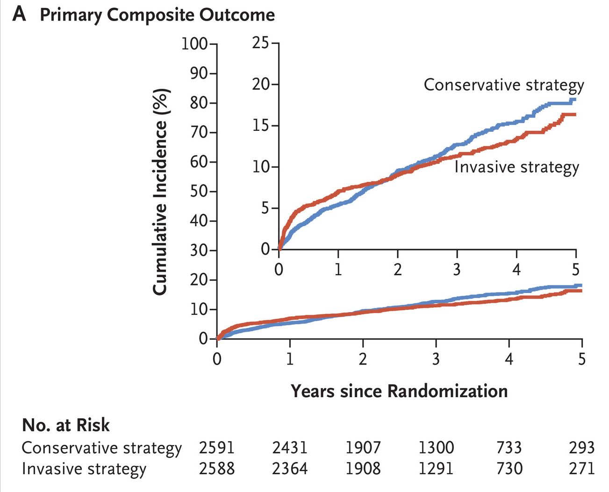
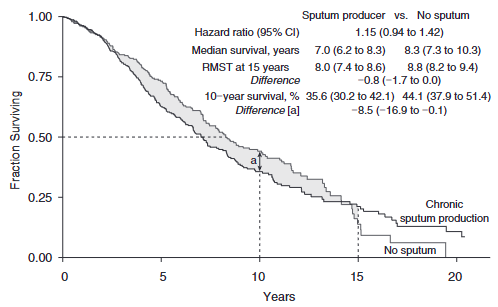
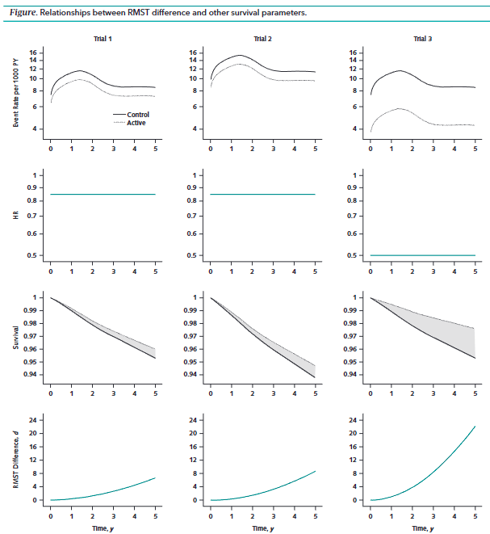

```{=html}
<style>
.reveal .reference {
  color: #666;
  font-size: 0.55em;
  margin-top: 0.6em;
  text-align: right;
}
.reveal .small {
  font-size: 0.72em;
}
.reveal .columns {
  gap: 1rem;
}
.reveal img {
  max-height: 64vh;
  object-fit: contain;
}
.reveal table {
  font-size: 0.48em;
}
</style>
```

## RMSTに関してあるいは、Cox回帰の限界

2020/4 ＠Keio University\
新美 望

## ある日のこと

```{r}
library(survival)
library(survRM2)
library(survRM2adapt)
library(rms)
library(Hmisc)

```

## 今日の内容

- 復習：生存解析
- Cox hazardの限界
- RMSTとは？
- RMSTは何がいいの？限界は？
- RMSTの使い方
- 観察研究での使い道

# 速習：生存解析

## 速習：生存解析

- 時間および、打ち切り(censor)が存在するイベントの有無の解析方法の総称(別名 time-to-event analysis)
  - 生存時間およびイベントの発症率の推定にKaplan-Meier法
  - 単純な比較にLog-rank検定
  - 影響の大きさの定量化や多変量調整にCoxハザードモデル
- 医学解析で最も多いと言っても過言ではない

::::: columns
::: {.column width="50%"}
```{r}
library(survival)
library(parameters)
library(ggsurvfit)

multi_colonfit <- coxph(Surv(time, status) ~ surg + rx + sex + age + obstruct + differ, data = colon) 

parameters::model_parameters(multi_colonfit, exponentiate = TRUE) |> 
  print(select = c("Parameter", "Coefficient", "CI_low", "CI_high", "p"))

```
:::

::: {.column width="50%"}
```{r}
library(survival)
library(parameters)
library(ggsurvfit)

survfit2(Surv(time, status) ~ surg, data = colon) |> 
  ggsurvfit::ggsurvfit() + 
  ggsurvfit::add_pvalue(location = "annotation") + 
  ggsurvfit::add_risktable(risktable_stats = "n.risk")
```
:::
:::::

# Cox回帰について

## Cox回帰について


- イベント発生のハザード比率が常に等しいという仮定のSemiparametricな解析
- 大元の生存曲線の形はどうでも良い(non parametric)
- 各々の共変量(下の式だとx1, x2...)の有無で瞬間の死亡率（hazard比）が変化する(parametric)

$h(t) = h_0exp\{b_1x_1 + b_2x_2 + ...b_px_p\}$

## Cox Modelの限界

- 共変量が時間に関わらずに同じように影響するという仮定が必要
- 他にも、[**比例ハザード性**]{style="color: red;font-size: 1.2em;"}がないといけない
  - Log-log plotなどで確認する
- 結果の言語化が実は難しい [@Dumas2025-dp]
- 例：REAL-CAD study
  - 高容量のピタバスタチンを内服すると、MACEがHR 0.8に減りました
  - 患者さんにHR 0.8をどう説明しますか？

## 本当ならダメな形！！

::::: columns
::: column
{fig-alt="比例ハザード性が成り立たない例1"}
:::

::: column
{fig-alt="比例ハザード性が成り立たない例2"}
:::
:::::

- COURAGE trialとISCHEMIA trialのKaplan-Meier曲線[@Boden2007-mi; @Maron2020-hg]
- 手技やOpeのtrialはこうなりがち

## Log-log Plot

```{r}
library(simsurv)
library(dplyr)
library(survival)
library(ggsurvfit)
library(patchwork)


good_hazard_fit <- ggsurvfit::survfit2(Surv(futime, death) ~  I(age >= 70), data = flchain) 

good_hazard_fig <- ggsurvfit::ggsurvfit(good_hazard_fit) + 
  labs(subtitle = "Good proportional hazard") + 
  theme(legend.position = "none")

good_hazard_cloglog_fig <- ggsurvfit::ggsurvfit(good_hazard_fit, type = "cloglog") + 
  scale_x_continuous(transform = "log") + 
  theme(legend.position = "none")


# GBMT 群は gamma > 1 なので、初期のハザードは低く、徐々に増加する。
set.seed(42)

gbmt <- simsurv(
  dist = "weibull", lambdas = 0.00038, gammas = 3,
  x = data.frame(id = 1:500), maxt = 12
)

# Intervention 群は gamma < 1 なので、初期のハザードは高く、徐々に低下する。
set.seed(42)

intervention <- simsurv(
  dist = "weibull", lambdas = 0.12, gammas = 0.4,
  x = data.frame(id = 501:1000), maxt = 12
)

dat <- rbind(
  base::transform(gbmt, group = "GBMT"),
  base::transform(intervention, group = "Intervention")
) |> 
  dplyr::mutate(eventtime = eventtime * 100)

bad_hazard_fit <- ggsurvfit::survfit2(Surv(eventtime, status) ~ group, data = dat) 


bad_hazard_fig <- ggsurvfit::ggsurvfit(bad_hazard_fit) + 
  labs(subtitle = "Bad proportional hazard") + 
  theme(legend.position = "none") 

bad_hazard_cloglog_fig <- ggsurvfit::ggsurvfit(bad_hazard_fit, type = "cloglog") + 
  scale_x_continuous(transform = "log") + 
  theme(legend.position = "none")

right_arrow <- patchwork::wrap_elements(
  panel = grid::segmentsGrob(
    x0 = 0.12, x1 = 0.88, y0 = 0.5, y1 = 0.5,
    arrow = grid::arrow(length = grid::unit(2.5, "mm"), type = "closed"),
    gp = grid::gpar(lwd = 3, col = "black", fill = "black")
  )
)

good_hazard_fig + right_arrow + good_hazard_cloglog_fig +
  bad_hazard_fig + right_arrow + bad_hazard_cloglog_fig +
  patchwork::plot_layout(ncol = 3, nrow = 2, widths = c(1, 0.16, 1))

```

- 横軸が時間、縦軸が `log{-log(S(t))}` のグラフ
- これが平行の時には比例hazard性が保たれていると判断
- わかりやすいのは元の曲線が交わっているか否か

## 小括

- 生存分析(time-to-event analysis)において、ある治療効果を定量的にみたい時にCox回帰が主流である
- しかし、Cox回帰には複数の弱点がある
  - Hazard ratioの数値の解釈が難しい
  - 比例ハザード性が保たれない時に回帰が行えない
- どうやって解決すればいい？

## RMSTとは

```{r}

library(survival)
library(ggsurvfit)
library(ggplot2)
library(broom)
library(dplyr)
library(tibble)
library(survRM2)

lung2 <- dplyr::mutate(lung, status = status - 1, arm = 1)

fit <- survfit2(
  Surv(time, status) ~ 1,
  data = lung2
)

rmst <- round(summary(fit, rmean = 500)$table[["rmean"]], 1)
rmtl <- 500 - rmst

interval_km_dat_pre <- broom::tidy(fit) |> 
  dplyr::filter(time <= 500) 

interval_km_dat <- interval_km_dat_pre |>
  dplyr::bind_rows(
    interval_km_dat_pre |>
      dplyr::slice_tail(n = 1) |>
      dplyr::mutate(time = 500)
  ) |> 
  dplyr::bind_rows(
    interval_km_dat_pre |>
      dplyr::slice_head(n = 1) |>
      dplyr::mutate(
        time = 0, 
        estimate = 1)
  )

p <- fit |>
  ggsurvfit() +
  add_risktable() +
  stat_stepribbon(
    dat = interval_km_dat,
    aes(x = time, ymin = 0, ymax = estimate),
    alpha = 0.15,
    color = NA, 
    fill = "steelblue"
  ) + 
  stat_stepribbon(
    dat = interval_km_dat,
    aes(x = time, ymin = estimate, ymax = 1.00),
    alpha = 0.15,
    color = NA, 
    fill = "pink"
  ) + 
  annotate("text", 
    x = 300, y = 0.25, label = paste0("RMST: ", rmst, "days")) + 
  annotate("text",
    x = 300, y = 0.85, label = paste0("RMTL: ", rmtl, "days"))

p

```

::::::: columns
:::::: {.column width="52%"}
- Restricted Mean Survival Timeの略
- ある特定の時間（τ）までの生存曲線の下の面積を計測したもの
  - 全時間を積分すると平均生存時間になる
  - τまでの生存曲線の上の面積を計測したものはRestricted mean time loss(RMTL)
- 近年、がん領域の研究でよく使われるようになっている

::::::
:::::::

## RMSTを用いた群間比較

$$\mu_\tau = \int_0^\tau S(t)\,\mathrm{d}t$$

とした時に 1. RMSTの差 $$\mu_\tau(1) - \mu_\tau(0)$$

2.  RMSTの比率(Ratio)

$$\mu_\tau(1) / \mu_\tau(0)$$

3.  RMTLの比率(Ratio)

$$\{\tau - \mu_\tau(1)\} / \{\tau - \mu_\tau(0)\}$$

- τまでの時間の平均値

- 比較には各々の治療群のRMSTの差や比をとる事が可能

- 多変量回帰として種々の因子の調整も可能

## RMSTの差の直観的理解



[@Harhay2018-te]

- この差の面積を考えてよい
- 途中で交差するとその分を引き算する

## HRとRMSTの関係

{fig-alt="HRとRMSTの関係"}

## 今日の内容

- 復習：生存解析
- Cox hazardの限界
- RMSTとは？
- RMSTは何がいいの？限界は？
- RMSTの使い方
- 観察研究での使い道

## RMSTは何がいいの？限界は？

- RMSTでは、複数の異なる研究の比較の時にフォローアップ時間が違っていても比較が可能とされる
- 臨床的解釈として「ある時間まで追跡した時の平均生存時間」という風に解釈が可能
- 例：薬を飲むと、10年後には1年間の寿命伸延効果があります
- 一番の注意点は、特定の時間τを臨床的に意味がある数字にする事
- τが決められない時は長めの時間をとるのがベター

## ハザードとの比較

+----------------+---------------------------------------------------+-----------------------------------------------------------------------------+
|                | RMSTの差                                          | Hazard ratio                                                                |
+================+===================================================+=============================================================================+
| 評価するもの   | 境界時間(τ)内で、平均生存時間がどの程度延長するか | リスクがどれほど減るか                                                      |
+----------------+---------------------------------------------------+-----------------------------------------------------------------------------+
| メリット       | - 比例ハザード性が成立しない状況でも使える        | - 比例ハザード性が成立していたら検出力が高い                                |
|                |                                                   |                                                                             |
|                | - 臨床的に解釈・説明がしやすい                    | - 全ての時間のデータを利用できる(RMSTはτまでの時間のデータしか使っていない) |
|                |                                                   |                                                                             |
|                | - 境界時間が一致している時に他試験との比較が容易  |                                                                             |
+----------------+---------------------------------------------------+-----------------------------------------------------------------------------+
| デメリット     | - 境界時間τについて明確な根拠が必要               | - 比例ハザード性が成立していない時の解釈は困難                              |
|                |                                                   |                                                                             |
|                |                                                   | - 臨床的に解釈・説明がしにくい                                              |
+----------------+---------------------------------------------------+-----------------------------------------------------------------------------+


## 評価指標の比較 {.scrollable}

+------------------+--------------------------+----------------------------------------------+--------------------------------------------+----------------------------------------------------------------------+----------------------------------------------------+
| 評価指標         | 時間                     | 意味                                         | 利点                                       | 欠点                                                                 | 特に適した状況                                     |
+==================+==========================+==============================================+============================================+======================================================================+====================================================+
| HR               | フォロー期間全部         | ある瞬間でのRiskの変化率の比率               | フォロー期間全部の情報を使える             | 直観的理解が困難<br>発症率が低いと広いCIになる                       | 研究：比例ハザードがある状況（非劣勢以外）         |
+------------------+--------------------------+----------------------------------------------+--------------------------------------------+----------------------------------------------------------------------+----------------------------------------------------+
| ARR              | ある特定の期間           | ある瞬間でのEvent freeの絶対差               | KM曲線から計算可能                         | KM曲線の形の差を捉えられない                                         | 研究と臨床：治療のインパクトの説明                 |
+------------------+--------------------------+----------------------------------------------+--------------------------------------------+----------------------------------------------------------------------+----------------------------------------------------+
| NNT              | ある特定の期間           | `1 / ARR`                                    | KM曲線から計算可能                         | 患者への説明が困難<br>KM曲線の形の差を捉えられない                   | 研究：介入の効果や有害事象への説明                 |
+------------------+--------------------------+----------------------------------------------+--------------------------------------------+----------------------------------------------------------------------+----------------------------------------------------+
| 中央生存時間の差 | 各々のグループである一点 | 各グループで生存率が50%になる時間の差        | KM曲線から計算可能<br>Robust               | Sample sizeやイベント率が低いと計算不可能                            | 研究：大規模研究や長期の研究、高いイベント率の研究 |
+------------------+--------------------------+----------------------------------------------+--------------------------------------------+----------------------------------------------------------------------+----------------------------------------------------+
| RMST             | ある特定の期間           | ある期間における平均イベントフリーの延長効果 | 直観的<br>非劣勢試験でも狭いCIで計算できる | 決めた期間より先について解釈できない<br>KM曲線の形の差を捉えられない | 研究と臨床：治療のインパクトの説明                 |
+------------------+--------------------------+----------------------------------------------+--------------------------------------------+----------------------------------------------------------------------+----------------------------------------------------+


## 胃がんデータの生存曲線

```{r}
library(readr)
library(here)
library(survival)
library(survRM2)

gastric <- readr::read_csv(here::here("statistics", "RMST_mi", "gastric.csv"))

survfit(Surv(time, status) ~ radiation, data = gastric) |> plot()

logrank <- survdiff(Surv(time, status) ~ radiation, data = gastric)
cox_fit <- coxph(Surv(time, status) ~ radiation, data = gastric)

```

## τ決定の重要性

```{r}

library(survival)
library(quarto)

gastric <- readr::read_csv(here::here("statistics", "RMST_mi", "gastric.csv"))

taus <- seq(500, 1700, by = 200)

fit <- survfit(
  Surv(time, status) ~ radiation,
  data = gastric
)

# KM推定値を右連続の階段関数にする
s0 <- stepfun(fit[1]$time, c(1, fit[1]$surv))
s1 <- stepfun(fit[2]$time, c(1, fit[2]$surv))

# 両群の観測時刻を共通の区切りとして使う
times <- sort(unique(c(
  0,
  fit$time[fit$time > 0 & fit$time < max(taus)],
  max(taus)
)))

km_data <- data.frame(
  time = times,
  s0 = s0(times),
  s1 = s1(times)
)

# τごとの統計量を事前計算
rmst_data <- lapply(taus, function(tau) {

  z <- survRM2::rmst2(
    time = gastric$time,
    status = gastric$status,
    arm = gastric$radiation,
    tau = tau
  )

  z$unadjusted.result |> tibble::as_tibble(rownames = "risk") |> dplyr::filter(stringr::str_detect(risk, "RMTL", negate = T)) |> dplyr::mutate(risk = if_else(risk == "RMST (arm=1)-(arm=0)", "diff", "ratio")) |> tidyr::pivot_wider(
    names_from = risk,
    values_from = c(Est., `lower .95`, `upper .95`, p),
    names_glue = "{risk}_{.value}"
  ) |>
  janitor::clean_names() |>
  dplyr::mutate(tau = tau)

}) |>
  dplyr::bind_rows()

# 画像ではなく数値データだけを渡す
ojs_define(
  km_data = km_data,
  rmst_data = rmst_data
)
```

```{ojs}
//| output: false

km = transpose(km_data)

stats = transpose(rmst_data)

positive = "#0072B2"

negative = "#D55E00"

fmt = (x, digits = 2) => Number(x).toFixed(digits)

fmtP = p => p < 0.001 ? "< 0.001" : p.toFixed(3)

// KM曲線の各水平区間
intervals = km.slice(0, -1).map((d, i) => ({
  start: d.time,
  end: km[i + 1].time,
  s0: d.s0,
  s1: d.s1
}))
```

```{ojs}
viewof tau = Inputs.range([500, 1700], {
  step: 200,
  value: 1100,
  label: "τ（日）"
})
```

```{ojs}
//| output: false

current = stats.find(d => d.tau === tau)

// τをまたぐ最後の区間はτで切る
area = intervals
  .filter(d => d.start < tau)
  .map(d => ({
    ...d,
    end: Math.min(d.end, tau)
  }))

kmPlot = Plot.plot({
  width: 640,
  height: 350,
  marginLeft: 65,
  marginBottom: 50,
  x: {
    domain: [0, 2000],
    label: "時間（日）"
  },
  y: {
    domain: [0, 1],
    label: "生存確率",
    grid: true
  },
  marks: [
    // 正の面積：放射線併用群の生存率が高い区間
    Plot.rect(area.filter(d => d.s1 > d.s0), {
      x1: "start", x2: "end",
      y1: "s0", y2: "s1",
      fill: positive,
      fillOpacity: 0.35
    }),

    // 負の面積：放射線併用群の生存率が低い区間
    Plot.rect(area.filter(d => d.s1 < d.s0), {
      x1: "start", x2: "end",
      y1: "s1", y2: "s0",
      fill: negative,
      fillOpacity: 0.35
    }),

    // KM曲線は右連続の階段関数として描く
    Plot.line(km, {
      x: "time",
      y: "s0",
      curve: "step-after",
      stroke: "#333333",
      strokeWidth: 2
    }),

    Plot.line(km, {
      x: "time",
      y: "s1",
      curve: "step-after",
      stroke: "#009E73",
      strokeWidth: 2,
      strokeDasharray: "6,4"
    }),

    Plot.ruleX([tau], {
      stroke: "#555",
      strokeDasharray: "4,4"
    })
  ]
})

diffPlot = Plot.plot({
  width: 510,
  height: 350,
  marginLeft: 75,
  marginBottom: 50,
  x: {
    domain: [500, 2000],
    ticks: stats.map(d => d.tau),
    label: "τ（日）"
  },
  y: {
    domain: [
      Math.min(0, ...stats.map(d => d.diff_lower_95)),
      Math.max(0, ...stats.map(d => d.diff_upper_95))
    ],
    label: "RMST差（日）：併用 − 単独",
    grid: true
  },
  marks: [
    Plot.ruleY([0], {
      stroke: "#777",
      strokeDasharray: "4,4"
    }),

    // 各τでの95%信頼区間
    Plot.ruleX(stats, {
      x: "tau",
      y1: "diff_lower_95",
      y2: "diff_upper_95",
      stroke: "#bbb"
    }),

    // 250日刻みの推定値を結ぶ
    Plot.line(stats, {
      x: "tau",
      y: "diff_est",
      stroke: "#999"
    }),

    Plot.dot(stats.filter(d => d.diff_est >= 0), {
      x: "tau", y: "diff_est",
      fill: positive,
      r: 4
    }),

    Plot.dot(stats.filter(d => d.diff_est < 0), {
      x: "tau", y: "diff_est",
      fill: negative,
      r: 4
    }),

    Plot.ruleX([tau], {
      stroke: "#555",
      strokeDasharray: "4,4"
    }),

    Plot.dot([current], {
      x: "tau",
      y: "diff_est",
      fill: current.diff_est >= 0 ? positive : negative,
      stroke: "black",
      r: 8
    })
  ]
})
```

```{ojs}
html`
<div style="display:grid; grid-template-columns:minmax(0, 640fr) minmax(0, 510fr); gap:16px;">
  <div>
    <div style="font-size:20px;">
      <span style="color:#333;">━ 化学療法単独</span>
      ／
      <span style="color:#009E73;">┄ 放射線併用</span>
    </div>
    ${kmPlot}
  </div>
  <div>
    <div style="font-size:20px;">RMST差と95%信頼区間</div>
    ${diffPlot}
  </div>
</div>
<div style="font-size:20px;">
  τまでの
  <span style="color:${positive};">青い面積</span>
  −
  <span style="color:${negative};">赤い面積</span>
  ＝ RMST差
</div>
`
```

```{ojs}
html`
<table style="width:100%; font-size:24px; margin-top:16px;">
  <thead>
    <tr>
      <th>τ = ${tau} 日</th>
      <th>推定値</th>
      <th>95%信頼区間</th>
      <th>p値</th>
    </tr>
  </thead>
  <tbody>
    <tr>
      <td>RMST差：併用 − 単独（日）</td>
      <td style=${`color:${
        current.diff_est >= 0 ? positive : negative
      }; font-weight:bold;`}>
        ${fmt(current.diff_est)}
      </td>
      <td>${fmt(current.diff_lower_95)} ～ ${fmt(current.diff_upper_95)}</td>
      <td>${fmtP(current.diff_p)}</td>
    </tr>
    <tr>
      <td>RMST比：併用 / 単独</td>
      <td>${fmt(current.ratio_est, 3)}</td>
      <td>
        ${fmt(current.ratio_lower_95, 3)} ～
        ${fmt(current.ratio_upper_95, 3)}
      </td>
      <td>${fmtP(current.ratio_p)}</td>
    </tr>
  </tbody>
</table>
`
```

## τの決め方～ISCHEMIAの場合

- ICTUS, FRISC-II, RITA-3などの過去のRCTのメタアナライシスに準じて5年という時間を決めている
- 5年restricted mean event-free timeの差は、invasive strategy群で9.5日長い
- 95% CIは -17.8から36.9日


## 観察研究での使い道

- 回帰式を用いて、交絡因子を調整することも出来る
  - Stroke. 2018;49:607-613.
- Propensity score match後に単変量でも可能
  - Open Heart. 2020;7:e001163.
- 近年、Risk model作成も行われている
  - Circ Cardiovasc Qual Outcomes. 2020;13:e005918.

## AIMの締めの言葉

- RCTにおいて、ルーチンでRMSTの差を使う事を推奨する

{fig-alt="AIMの締めの言葉" width="70%"}

## ご静聴ありがとうございました
