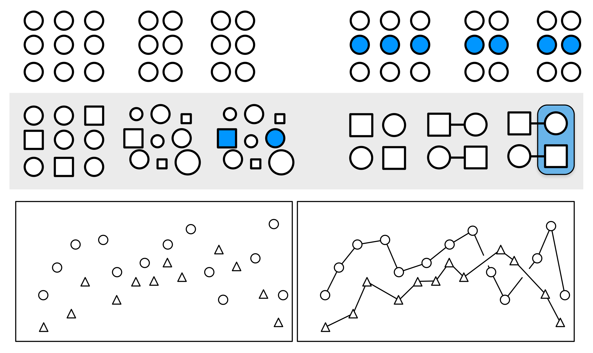

```{=html}
<style>
.reveal .reference {
  color: #666;
  font-size: 0.55em;
  margin-top: 0.6em;
  text-align: right;
}
.reveal .small {
  font-size: 0.76em;
}
.reveal .columns {
  gap: 1rem;
}
.reveal img {
  max-height: 64vh;
  object-fit: contain;
}
blockquote {
  font-size: 0.82em;
}
</style>
```

```{r}
#| label: set-up
library(grateful)
library(tidyverse)
library(ggpubr)
library(patchwork)
library(plotrix)

```


## Take Home Message

- まず、最初に何を見せたいのかを3つから考える
  - 分布
  - 関係
  - 差・比率
- 差・比率を見せる時は極力長さで表す
  - 面積は使わない
- 最もシンプルな図を実現する
  - データ・インク比率が良いもの
- Nや分布にも配慮する
  - 連続値に棒グラフは避ける
- 色覚多様性にも配慮した色を使う

## What Is This？

```{r}
#| label: anscombes

library(tidyverse)
library(ggpubr)

anscombe_long <- tidyr::pivot_longer(
  anscombe,
  cols = everything(),
  names_to = c(".value", "set"),
  names_pattern = "([xy])(\\d+)",
  names_transform = list(set = as.integer)
) 

anscombe_fig <- ggpubr::ggscatter(data = anscombe_long, x = "x", y = "y", facet.by = "set") + 
  ylim(c(0, 16)) + 
  theme_bw()

anscombe_fig

ggpubr::ggscatter(data = anscombe_long, x = "x", y = "y", facet.by = "set", add = "reg.line") +
  ylim(c(0, 17)) + 
  ggpubr::stat_regline_equation(label.x = 5, label.y = 16) +
  ggpubr::stat_cor(label.x = 5, label.y = 14, digits = 2, p.accuracy = 0.01) + 
  theme_bw()

```

- Anscombe's Quartet
  - 上記、相関係数と回帰直線に加えて・・・・・・
  - Xの平均 9, 分散 11
  - yの平均 7.50, 分散 4.1
- でも全く違う形

## Visualization

- Tableと異なり、Figureにすることで情報量は格段に上がる
- 一方で、適切なFigureを描かないと見にくいばかりか、misleadingにもなりうる
- 内科の問診のように、基礎中の基礎だけど重要極まりない工程
- Visualizationって誰かに習ったっけ？

## 今日の内容

- Visualization：良いFigureの条件
- データ・インク比
- 見せたいものと人間の得意分野
- Nへの意識
- 3次元プロットって？
- Tips：Gestaltと色使いについて

## 今日の内容

- Visualization：良いFigureの条件
- データ・インク比
- 見せたいものと人間の得意分野
- Nへの意識
- 3次元プロットって？
- Tips：Gestaltと色使いについて

## よいFigureの条件

:::: columns

::: {.column width="42%"}
{fig-alt="Edward Tufte" width="60%"}

Edward Tufte

:::

::: {.column width="58%"}
> すばらしいグラフは興味深いデータを, よく工夫して表現したものです. これはデータの中身の問題であり, 統計の問題であり, そして ##デザイン## の問題です. ...(中略)... よいグラフは読み手に対して最小のスペース・最小のインクによって最小の時間で最大限のアイディアを与えてくれます. 
[@kiranhiri2021-fw]
:::
::::

## 非常に良いFigureの見本


{fig-alt="非常に良いFigureの見本" width="100%"}

- ？？？

## よいFigureの条件

:::: columns
::: {.column width="58%"}
> 優れたFigureとはよくデザインされた興味深いデータ、データそのものや統計、そしてデザインの問題です。透明性・精確性・効率性が複雑に絡み合っています。最も少ないインク・スペースを用いて見たものに即座にいくつもの素晴らしいアイデアを示すことが可能です。

- データ・インク比を最大化する
:::

::: {.column width="42%"}
{fig-alt="Edward Tufte" width="60%"}

:::
::::

## 今日の内容

- Visualization：良いFigureの条件
- データ・インク比
- 見せたいものと人間の得意分野
- Nへの意識
- 3次元プロットって？
- Tips：Gestaltと色使いについて

## インク・データ比の法則

:::: columns
::: {.column width="52%"}
- そのプロットの中で意味がある部分と、使ったインクの割合を小さくすることが良いプロットの条件
- 簡単にいうと「シンプル イズ ベスト」
:::

::: {.column width="48%"}
{fig-alt="インク・データ比の例1" width="66%"}
[@Weissgerber2019-ho]

```{r}
#| label: bad-ink-data-ratio

library(ggplot2)
library(dplyr)
library(cowplot)
library(grid)

base_irisplot <- dplyr::summarise(iris, Sepal_Width = mean(Sepal.Width), .by = Species) |> 
  ggplot() + 
  geom_col(aes(x = Species, y = Sepal_Width, fill = Species)) + 
  theme_bw()

g_circle <- grid::roundrectGrob(
  x = 0.9125, y = 0.5, width = 0.17, height = 0.3, 
  r = unit(0.02, "snpc"),
  gp = gpar(col = "red", fill = NA, lwd = 3)
)

g_arrow <- grid::segmentsGrob(
  x0 = 0.8, y0 = 1.0,
  x1 = 0.7, y1 = 0.85,
  arrow = arrow(length = unit(0.15, "inches")),
  gp = gpar(col = "red", lwd = 2)
)

ggdraw(base_irisplot) +
  draw_grob(g_circle, x = 0, y = 0, width = 1, height = 1) + 
  draw_grob(g_arrow,  0, 0, 1, 1)


```

:::
::::


## 見せたいものって？

:::: columns
::: {.column width="44%"}
- 見せたいものは大体この3種類に大別
  - 関係性
  - 分布
  - 比率・差
- この6種類が基本
  - 散布図
  - ヒストグラム
  - 折れ線グラフ
  - 箱ひげ図
  - ドットチャート
  - 棒グラフ
:::

::: {.column width="56%"}
{fig-alt="見せたいものと図の種類" width="100%"}
:::
[@waskom_seaborn_function_overview]

::::

## 人間の得意・苦手分野

{fig-alt="Example 元図" width="80%"}

[@kiranhiri2021-fw]

## Example

- 青が感染症
- 赤が戦場での負傷
- 黒がその他
- どちらが分かりやすいですか？


:::: columns
::: {.column width="50%"}


:::

::: {.column width="50%"}

```{r}
library(Rdatasets)
library(marginaleffects)
library(lubridate)
library(dplyr)
library(ggplot2)

nightingale <- marginaleffects::get_dataset("Nightingale") |> 
  dplyr::mutate(Date = lubridate::ymd(Date))

tidyr::pivot_longer(
  nightingale, 
  cols = c("Disease.rate", "Wounds.rate", "Other.rate")
  ) |> 
    ggplot() + 
    geom_line(aes(x = Date, y = value, color = name)) + 
    theme_bw()

```

:::
::::

## 今日の内容

- Visualization：良いFigureの条件
- データ・インク比
- 見せたいものと人間の得意分野
- Nへの意識
- 3次元プロットって？
- Tips：Gestaltと色使いについて

## Nへの意識

- 連続値の平均や中央値を比較する時には分布も非常に重要
- 分布を見る時にはバイオリンプロットもよい
- サンプルサイズの大きさで、使う図表を分けるべき
- 一つの目安として `n < 30` ではドットチャートを併用する

:::: columns
::: {.column width="50%"}

```{r}
library(ggpubr)

ggpubr::ggviolin(
  data = ToothGrowth, 
  x = "dose", 
  y = "len"
  )

```

:::

::: {.column width="50%"}

```{r}
library(ggpubr)

ggpubr::ggdotplot(
  data = ToothGrowth, 
  x = "dose", 
  y = "len", 
  fill = "supp"
  )

```

:::
::::

## What’s This？

- STEMI患者のPCI後のCKの値の平均
- STEMI患者のPCI後のCKの値の中央値
- ???


```{r}

set.seed(42)

male <- rnorm(70, mean = 4000, sd = 500)
female <- rlnorm(
  50,
  meanlog = log(2500) - 0.5 * 1^2,
  sdlog   = 1
)

female <- female[female > 4000 | female < 2000]


dat <- data.frame(
  sex = factor(
    rep(c("Male", "Female"), c(length(male), length(female))),
    levels = c("Male", "Female")
  ),
  ck_peak = c(male, female)
)


library(ggpubr)
library(dplyr)
library(patchwork)


mean_bar_simple <- dplyr::summarise(
  dat, 
  ck_peak = mean(ck_peak), 
  .by = sex
) |> 
  ggpubr::ggbarplot(
    x = "sex", 
    y = "ck_peak"
)


median_bar_simple <- dplyr::summarise(
  dat, 
  ck_peak = median(ck_peak), 
  .by = sex
) |> 
  ggpubr::ggbarplot(
    x = "sex", 
    y = "ck_peak"
)

mean_bar_simple + median_bar_simple

```


## What’s This？

```{r}
library(ggpubr)
library(patchwork)

mean_bar <- ggbarplot(dat,
  x = "sex", y = "ck_peak",
  add = "mean_se"
)

median_bar <- ggbarplot(dat,
  x = "sex", y = "ck_peak",
  add = "median_q1q3"
)

mean_bar + median_bar

```


## That’s It!!


```{r}
library(ggpubr)
library(patchwork)
library(ggdist)

all_plot <- ggplot(dat, aes(x = sex, y = ck_peak)) +
  stat_dotsinterval(side = "bottom", scale = 0.7, slab_linewidth = NA) + 
  scale_fill_brewer(palette = "Set2") +
  theme_bw()

male_plot <- ggplot(dplyr::filter(dat, sex == "Male"), aes(x = sex, y = ck_peak)) +
  stat_dotsinterval(side = "bottom", scale = 0.3, slab_linewidth = NA) + 
  scale_fill_brewer(palette = "Set2") +
  theme_bw()

female_plot <- ggplot(dplyr::filter(dat, sex == "Female"), aes(x = sex, y = ck_peak)) +
  stat_dotsinterval(side = "bottom", scale = 0.3, slab_linewidth = NA) + 
  scale_fill_brewer(palette = "Set2") +
  theme_bw()

all_plot + male_plot + female_plot

```


## Nへの意識

:::: columns
::: {.column width="48%"}
- 何かの比較の時には必ず分布も考慮する
- 箱ひげ図やバイオリンプロットは非常に見やすい
- 一方で、Nが小さいときにはその意味も変わる
- Nが少ないときはそのデータも入れた方が良い
:::

```{r}

library(ggplot2)
library(ggpubr)
library(patchwork)

set.seed(42)

panels <- c("n = 100", "n = 20", "n = 5")

population <- tibble::tibble(
  x = " ",
  data = rnorm(500, mean = 10, sd = 2)
)

sample <- tibble::tibble(
  population = panels, 
  n = c(100, 20, 5)
) |> 
dplyr::mutate(
  data = purrr::map(n, \(x)rnorm(x, mean = 10, sd = 2))
) |> 
tidyr::unnest_longer(data)

violin <- ggpubr::ggviolin(
  data = population, 
  x = "x", y = "data"
)

dotplot <- ggpubr::ggdotplot(
  data = sample, 
  x = "population", y = "data") 

violin + dotplot +  plot_layout(widths = c(1, 3))

```


::::

## Nへの意識と見やすさの両立

{fig-alt="ドットチャートと要約1""}

- ドットチャートに要約（平均・中央値）を追加する
- ドットを出来るだけ薄くする[@Weissgerber2019-ho]


## まとめ

{fig-alt="まとめ図"}

[@Weissgerber2019-ho]

## 今日の内容

- Visualization：良いFigureの条件
- データ・インク比
- 見せたいものと人間の得意分野
- Nへの意識
- 3次元プロットって？
- Tips：Gestaltと色使いについて

## 3次元プロットって？


```{r}

library(plotrix)

three_d_data <- tibble::tibble(
  age = c("10s", "20s", "30s", "40s", "50s", "60s", "70s", "80s"), 
  count = c(13, 10, 13, 20, 13, 30, 13, 40)
)

plotrix::pie3D(
  x = three_d_data$count,
  labels = sprintf(
    "%s\n%d (%.1f%%)",
    three_d_data$age,
    three_d_data$count,
    100 * three_d_data$count / sum(three_d_data$count)
  ),
  col = hcl.colors(nrow(three_d_data), "Set 2"),
  height = 0.1,       # 円グラフの厚み
  theta = pi / 6,    # 見下ろす角度
  explode = 0,       # 扇形を離す距離
  border = "white",
  labelcex = 0.9
)

```

- 基本的にはmisleading
- 使わなくて済むなら絶対に使わない
- 一番ダメなのが3次元円グラフ
  - 4つの"13"は同じ大きさに見えますか？
  - 13に挟まれた数値はどれが一番大きく見えますか？


## どちらが見やすい？

```{r}

library(tidyverse)
library(ggcube)
library(patchwork)

# サンプルデータでの3D棒グラフ作成例

df_3d <- tidyr::crossing(
  tibble(
    x = c("A", "B", "C"), 
    x_val = c(0.5, 1, 1.5)
    ), 
  tibble(
    y = c("P", "Q", "R"), 
    y_val = c(2, 4, 6)
    )) |> 
  dplyr::mutate(
    mean = x_val * y_val,
    z = rnorm(9, mean = mean, sd = 0.5)
  )

plot_3d <- ggplot(df_3d, aes(x = x, y = y, z = z)) +
  geom_bar_3d() +
  coord_3d() + 
  theme_bw()

plot_2d <- ggplot(df_3d) + 
  geom_col(aes(x = x, y = z)) + 
  facet_wrap(~y) + 
  theme_bw()

plot_3d + plot_2d

```


## Stacked-barとaligned barについて

- 縦に重ねた棒グラフと横に重ねた棒グラフ
- どちらが良いですか？

## 棒グラフが見せたいもの

- 棒グラフは横に並べて長さで差や比率を示すもの
- 途中でBreakしている棒グラフは決して使ってはいけない
- そういう意味で、積み重ねの棒グラフは一番下がそろっていないので×
- 事実、長さを間違える人が多い事が知られている[@Talbot2014-bo]

## Stacked bar and algined bar graph

```{r}
library(patchwork)

stacked_bar <- ggplot(df_3d) + 
  geom_col(aes(x = x, y = z, fill = y), position = "stack") + 
  theme_bw()

dodged_bar <- ggplot(df_3d) + 
  geom_col(aes(x = x, y = z, fill = y), position = position_dodge2()) + 
  theme_bw()

stacked_bar + dodged_bar + plot_layout(guides = "collect")

```

- どっちが見やすい？

## ゲシュタルトとは

{fig-alt="ゲシュタルトの法則" width="100%"}


- 少ない視覚的情報から要素間の関係性を推論すること
- 主に以下の法則が存在する
  - 近接性(Proximity):空間的に近いものは互いに関連しているように見える
  - 類似性(Similarity):見た目が似ているものは関係しているように見える
  - 接続性(Coneetction):視覚的に結び付けられているもの同士は関係を持っているように見える
  - 連続性(Continuity):一部が隠されているオブジェクトは親和性のある形に補完される
  - 閉鎖性(Closure):不完全な形は完全なものとして知覚される
  - 共通の運命(Common fate):同じ方向に移動するオブジェクトは1つの群として認識される


## 推奨はしないけど

```{r}


no_gestalt_fig <- ggplot(df_3d, aes(x = x, y = y, z = z)) +
  geom_bar_3d(colour = "black") +
  coord_3d() + 
  theme_bw()


gestalt_fig <- ggplot(df_3d, aes(x = x, y = y, z = z, fill = y)) +
  geom_bar_3d(colour = "black") +
  coord_3d() + 
  theme_bw()

no_gestalt_fig + gestalt_fig + plot_layout(guides = "collect")

```

- 右の方が、まだ視線を誘導できる

## 色使いについて

- いわゆる色覚異常は一般人口で約3%おり非常にCommon[@Jeong2025-bw]
  - 男性により多い
- 読者・査読者にもいるかも知れないので色使いは皆に優しい方が良い


## カラーユニバーサルデザイン

- 具体的な色彩の選び方は以下を参照
- <https://www.fukushihoken.metro.tokyo.lg.jp/kiban/machizukuri/kanren/color.files/colorudguideline.pdf>


## Rで使えるカラーパレット

```{r}

# install.packages("RColorBrewer")
library(RColorBrewer)

# 色覚多様性に配慮したパレットを表示
display.brewer.all(colorblindFriendly = TRUE)

```

## おすすめ

- カテゴリー変数はOkabe-Ito
- 連続値はViridisがおすすめ！
- 正負を強調する時はDiverginc HCLが良い

```{r}
library(viridisLite)

# Palettes
palettes <- list(
  "Okabe-Ito" = palette.colors(
    palette = "Okabe-Ito"
  ),
  "Viridis" = viridisLite::viridis(8),
  "Diverging HCL" = hcl.colors(
    9,
    palette = "Blue-Red 3"
  )
)

# Paletteを描画する関数
show_palette <- function(cols, main = "") {
  n <- length(cols)

  plot(
    NA,
    xlim = c(0.5, n + 0.5),
    ylim = c(0, 1),
    axes = FALSE,
    xlab = "",
    ylab = "",
    main = main
  )

  rect(
    xleft   = seq_len(n) - 0.5,
    ybottom = 0,
    xright  = seq_len(n) + 0.5,
    ytop    = 1,
    col     = cols,
    border  = NA
  )
}

# 3つを縦に並べて表示
op <- par(
  mfrow = c(3, 1),
  mar = c(1, 3, 2, 1)
)

for (nm in names(palettes)) {
  show_palette(palettes[[nm]], nm)
}

par(op)

```

## 各JournalのVisualizationの推奨

| Journal | 明示的に避けるもの | Continuous dataの推奨 | nに関する記載 |
|---|---|---|---|
| **JAMA**[^JAMA] | **Pie chart、3D graph、stacked bar chart**を避ける。Bar graphは原則としてfrequency data（number、percentage、rate）のみに使用する。 | MeanやORなどのsummary estimateはbarではなく**data marker + error bar**で表示する。OR、RR、HRなどは実値を**log scale**上にplotする。 | 原則として`No. (%)`で表示。**n < 100ではpercentageに小数を付けない**。小標本ではnumerator/denominatorの併記を重視。 |
| **Annals of Internal Medicine (AIM)**[^AIM] | **Pie chart、3-dimensional graphic**を避ける。Variabilityを十分に示さない単純なbar plotを避ける。 | Continuous dataではvariabilityを示す。推定値の不確実性は可能であれば**SEよりconfidence interval**を用いる。 | **n < 200ではpercentageは整数**、**n ≥ 200では小数1桁**を基本とする。 |
| **NEJM**[^NEJM] | 公開Author Guidelineでは、pie chart、3D graph、dynamite plotについての一律の明示的禁止は確認できない。 | Statistical estimateには**effect estimate + SEまたはCI**を提示する。重要なsubgroup analysisには**forest plot**を推奨。 | Figure typeをnで切り替える明示的な基準はない。数値のprecisionはsample sizeに見合ったものとする。 |
| **The BMJ**[^BMJ] | Histogram等は**simple 2-dimensional format**とし、background gridを避ける。3D表示を積極的に用いることは推奨されない。 | Graph、scattergram、histogramを用いる場合には、必要に応じて**underlying numerical data**も提出する。Tableの方が明瞭であればtableが優先されることがある。 | Plot typeをsample sizeで切り替える明示的な基準はない。 |
| **The Lancet**[^Lancet] | **3D graphは可能であれば1つ以上の2D graphへ変換**する。 | 明瞭な**2D presentation**を基本とし、axis、line、symbol、colour contrastを適切に設定する。 | Plot typeをsample sizeで切り替える明示的な基準はない。 |
| **JACC**[^JACC] | **Bar graphはcounts/proportions以外では避ける**。特にcontinuous dataをbarのみで要約することを避ける。 | Continuous data、特に**small sample sizeではdot plot / scatter plot等でfull data distributionを示す**。 | Small sampleでは個々のdata pointやfull distributionを示すことを推奨。具体的なnのcutoffは規定されていない。 |
| **European Heart Journal (EHJ)**[^EHJ] | Misleadingなaxis truncationや、小さな差を視覚的に誇張する表示を避ける。公開EHJ guidelineではdynamite plot、pie chart、3D graphの一律禁止は明示されていない。 | 大きなtableより、key messageを明瞭に示せる場合は**graphical presentation**を推奨。Kaplan–Meier curveではnumber at riskの表示を推奨。 | Figure legend等に**number of animals / cells / observations**を明示する。Plot typeをnで切り替える明示的なcutoffはない。 |
| **Circulation / AHA Journals**[^AHA] | **Bar graphはcounts/proportions以外では避ける**。Continuous dataをbarだけで要約しない。 | Continuous data、特に**small nではdot plot / scatter plotでfull distributionを表示**する。Dense dataではviolin plot等も使用可能。可能な場合はindividual data pointsを示す。 | **各groupのnをfigure/tableに明示**する。Small nではraw dataを重視するが、dot/box/violinを切り替える一律のn cutoffは規定されていない。 |

[^JAMA]: JAMA. *Instructions for Authors*. <https://jamanetwork.com/journals/jama/pages/instructions-for-authors>

[^AIM]: Annals of Internal Medicine. *Statistical Guidance*. <https://www.acpjournals.org/journal/aim/authors/statistical-guidance>

[^NEJM]: New England Journal of Medicine. *Author Center: New Manuscripts*. <https://www.nejm.org/author-center/new-manuscripts>

[^BMJ]: BMJ Author Hub. *Formatting your paper*. <https://authors.bmj.com/writing-and-formatting/formatting-your-paper/>; The BMJ. *House Style*. <https://www.bmj.com/about-bmj/resources-authors/house-style>

[^Lancet]: The Lancet. *Artwork Guidelines*. <https://www.lancet.com/pb/assets/raw/Lancet/authors/artwork-guidelines.pdf>

[^JACC]: Journal of the American College of Cardiology. *Publication Ethics / Data Visualization Guidelines*. <https://www.jacc.org/author-center/publication-ethics>

[^EHJ]: European Heart Journal. *Statistical Guidelines*. <https://academic.oup.com/eurheartj/pages/Statistical_Guidelines_>; *General Instructions*. <https://academic.oup.com/eurheartj/pages/General_Instructions>

[^AHA]: American Heart Association Journals. *Figure Guidelines*. <https://www.ahajournals.org/figure-guidelines>; *Statistical Reporting Recommendations*. <https://www.ahajournals.org/statistical-recommendations>; Circulation. *Manuscript Preparation*. <https://www.ahajournals.org/circ/manuscript-preparation>

## Take Home Message

- まず、最初に何を見せたいのかを3つから考える
  - 分布
  - 関係
  - 差・比率
- 差・比率を見せる時は極力長さで表す
  - 面積は使わない
- 最もシンプルな図を実現する
  - データ・インク比率が良いもの
- Nや分布にも配慮する
  - 連続値に棒グラフは避ける
- 色覚多様性にも配慮した色を使う

## Reference

```{r}
grateful::cite_packages(output = "paragraph", out.dir = here::here("statistics", "visualization_mi"), pkgs = here::here("statistics", "visualization_mi", "index.qmd"), out.format = "html")
```

::: {#refs}
:::


## ご静聴ありがとうございました


