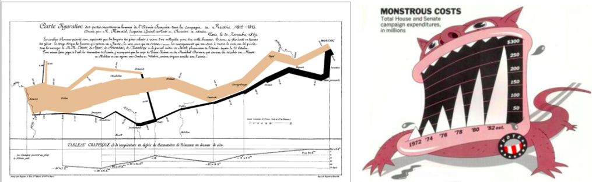
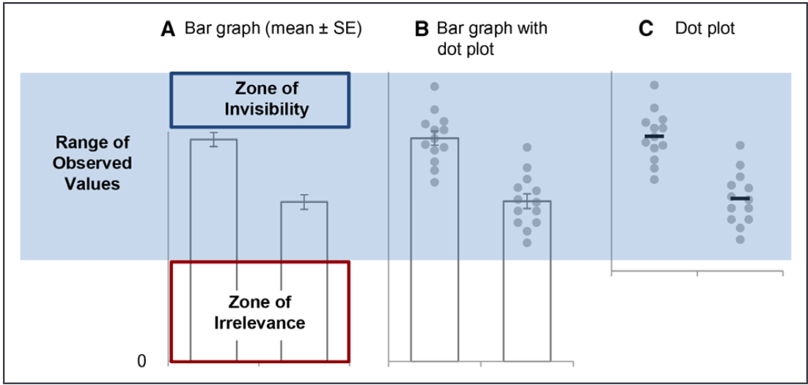
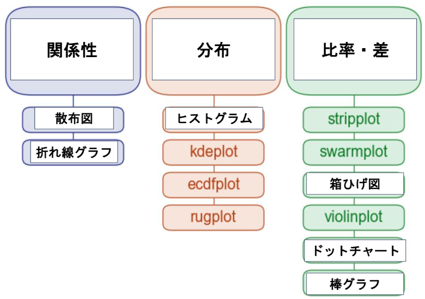
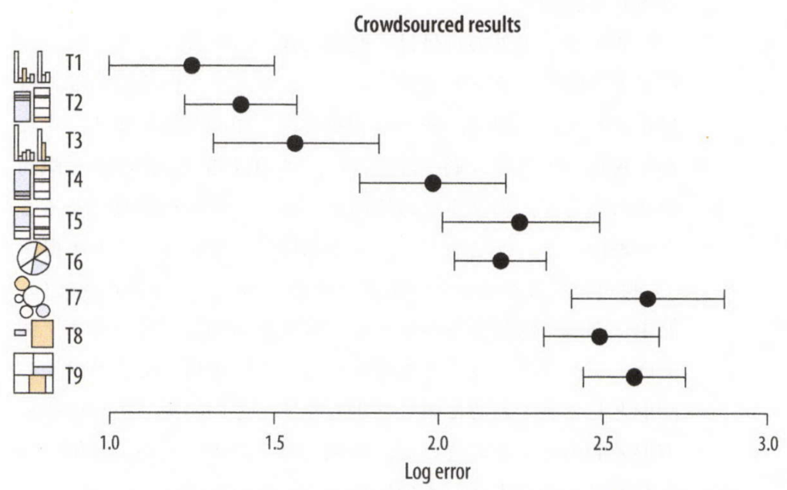
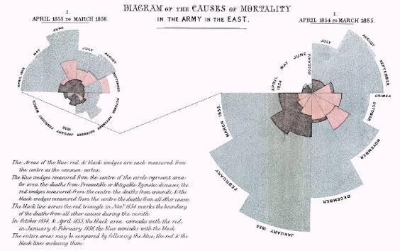
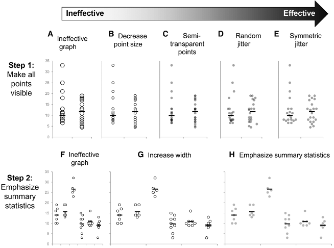
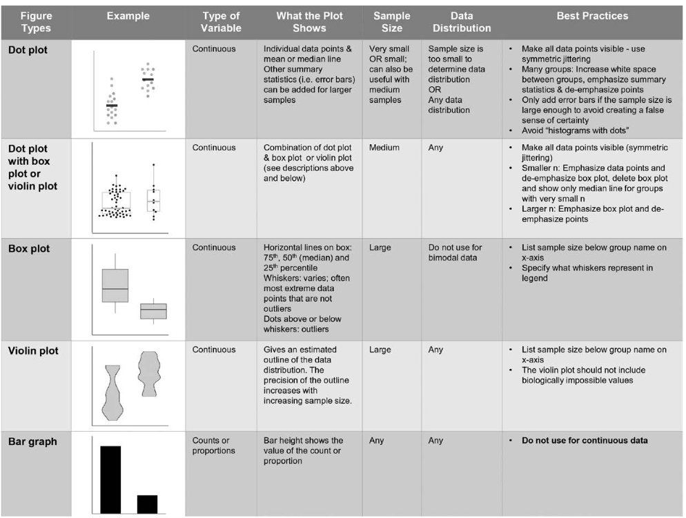

```{=html}
<style>
.reveal .reference {
  color: #666;
  font-size: 0.55em;
  margin-top: 0.6em;
  text-align: right;
}
.reveal .small {
  font-size: 0.76em;
}
.reveal .columns {
  gap: 1rem;
}
.reveal img {
  max-height: 64vh;
  object-fit: contain;
}
blockquote {
  font-size: 0.82em;
}
</style>
```

```{r}
#| label: set-up
library(grateful)
library(tidyverse)
library(ggpubr)
library(patchwork)
library(ggpie)

```


## Take Home Message

- まず、最初に何を見せたいのかを3つから考える
  - 分布
  - 関係
  - 差・比率
- 差・比率を見せる時は極力長さで表す
  - 面積は使わない
- 最もシンプルな図を実現する
  - データ・インク比率が良いもの
- Nや分布にも配慮する
  - 連続値に棒グラフは避ける
- 色覚多様性にも配慮した色を使う

## What Is This？

```{r}
#| label: anscombes

library(tidyverse)
library(ggpubr)

anscombe_long <- tidyr::pivot_longer(
  anscombe,
  cols = everything(),
  names_to = c(".value", "set"),
  names_pattern = "([xy])(\\d+)",
  names_transform = list(set = as.integer)
) 

anscombe_fig <- ggpubr::ggscatter(data = anscombe_long, x = "x", y = "y", facet.by = "set") + 
  ylim(c(0, 16)) + 
  theme_bw()

anscombe_fig

ggpubr::ggscatter(data = anscombe_long, x = "x", y = "y", facet.by = "set", add = "reg.line") +
  ylim(c(0, 17)) + 
  ggpubr::stat_regline_equation(label.x = 5, label.y = 16) +
  ggpubr::stat_cor(label.x = 5, label.y = 14, digits = 2, p.accuracy = 0.01) + 
  theme_bw()

```

- Anscombe's Quartet
  - 上記、相関係数と回帰直線に加えて・・・・・・
  - Xの平均 9, 分散 11
  - yの平均 7.50, 分散 4.1
- でも全く違う形

## Visualization

- Tableと異なり、Figureにすることで情報量は格段に上がる
- 一方で、適切なFigureを描かないと見にくいばかりか、misleadingにもなりうる
- 内科の問診のように、基礎中の基礎だけど重要極まりない工程
- Visualizationって誰かに習ったっけ？

## 今日の内容

- Visualization：良いFigureの条件
- データ・インク比
- 見せたいものと人間の得意分野
- Nへの意識
- 3次元プロットって？
- Tips：Gestaltと色使いについて

## 今日の内容

- Visualization：良いFigureの条件
- データ・インク比
- 見せたいものと人間の得意分野
- Nへの意識
- 3次元プロットって？
- Tips：Gestaltと色使いについて

## よいFigureの条件

:::: columns

::: {.column width="42%"}
{fig-alt="Edward Tufte" width="60%"}

Edward Tufte

:::

::: {.column width="58%"}
> すばらしいグラフは興味深いデータを, よく工夫して表現したものです. これはデータの中身の問題であり, 統計の問題であり, そして ##デザイン## の問題です. ...(中略)... よいグラフは読み手に対して最小のスペース・最小のインクによって最小の時間で最大限のアイディアを与えてくれます. 
[@kiranhiri2021-fw]
:::
::::

## 非常に良いFigureの見本


{fig-alt="非常に良いFigureの見本" width="100%"}

- ？？？

## よいFigureの条件

:::: columns
::: {.column width="58%"}
> 優れたFigureとはよくデザインされた興味深いデータ、データそのものや統計、そしてデザインの問題です。透明性・精確性・効率性が複雑に絡み合っています。最も少ないインク・スペースを用いて見たものに即座にいくつもの素晴らしいアイデアを示すことが可能です。

- データ・インク比を最大化する
:::

::: {.column width="42%"}
{fig-alt="Edward Tufte" width="60%"}

:::
::::

## 今日の内容

- Visualization：良いFigureの条件
- データ・インク比
- 見せたいものと人間の得意分野
- Nへの意識
- 3次元プロットって？
- Tips：Gestaltと色使いについて

## インク・データ比の法則

:::: columns
::: {.column width="52%"}
- そのプロットの中で意味がある部分と、使ったインクの割合を小さくすることが良いプロットの条件
- 簡単にいうと「シンプル イズ ベスト」
:::

::: {.column width="48%"}
{fig-alt="インク・データ比の例1" width="66%"}
[@Weissgerber2019-ho]

```{r}
#| label: bad-ink-data-ratio

library(ggplot2)
library(dplyr)
library(cowplot)
library(grid)

base_irisplot <- dplyr::summarise(iris, Sepal_Width = mean(Sepal.Width), .by = Species) |> 
  ggplot() + 
  geom_col(aes(x = Species, y = Sepal_Width, fill = Species)) + 
  theme_bw()

g_circle <- grid::roundrectGrob(
  x = 0.9125, y = 0.5, width = 0.17, height = 0.3, 
  r = unit(0.02, "snpc"),
  gp = gpar(col = "red", fill = NA, lwd = 3)
)

g_arrow <- grid::segmentsGrob(
  x0 = 0.8, y0 = 1.0,
  x1 = 0.7, y1 = 0.85,
  arrow = arrow(length = unit(0.15, "inches")),
  gp = gpar(col = "red", lwd = 2)
)

ggdraw(base_irisplot) +
  draw_grob(g_circle, x = 0, y = 0, width = 1, height = 1) + 
  draw_grob(g_arrow,  0, 0, 1, 1)


```

:::
::::


## 見せたいものって？

:::: columns
::: {.column width="44%"}
- 見せたいものは大体この3種類に大別
  - 関係性
  - 分布
  - 比率・差
- この6種類が基本
  - 散布図
  - ヒストグラム
  - 折れ線グラフ
  - 箱ひげ図
  - ドットチャート
  - 棒グラフ
:::

::: {.column width="56%"}
{fig-alt="見せたいものと図の種類" width="100%"}
:::
[@waskom_seaborn_function_overview]

::::

## 人間の得意・苦手分野

{fig-alt="Example 元図" width="80%"}

[@kiranhiri2021-fw]

## Example

- 青が感染症
- 赤が戦場での負傷
- 黒がその他
- どちらが分かりやすいですか？


:::: columns
::: {.column width="50%"}



:::

::: {.column width="50%"}

```{r}
library(Rdatasets)
library(marginaleffects)
library(lubridate)
library(dplyr)
library(ggplot2)

nightingale <- marginaleffects::get_dataset("Nightingale") |> 
  dplyr::mutate(Date = lubridate::ymd(Date))

tidyr::pivot_longer(
  nightingale, 
  cols = c("Disease.rate", "Wounds.rate", "Other.rate")
  ) |> 
    ggplot() + 
    geom_line(aes(x = Date, y = value, color = name)) + 
    theme_bw()

```

:::
::::

## 今日の内容

- Visualization：良いFigureの条件
- データ・インク比
- 見せたいものと人間の得意分野
- Nへの意識
- 3次元プロットって？
- Tips：Gestaltと色使いについて

## Nへの意識

- 連続値の平均や中央値を比較する時には分布も非常に重要
- 分布を見る時にはバイオリンプロットもよい
- サンプルサイズの大きさで、使う図表を分けるべき
- 一つの目安として `n < 30` ではドットチャートを併用する

:::: columns
::: {.column width="50%"}

```{r}
library(ggpubr)

ggpubr::ggviolin(
  data = ToothGrowth, 
  x = "dose", 
  y = "len"
  )

```

:::

::: {.column width="50%"}

```{r}
library(ggpubr)

ggpubr::ggdotplot(
  data = ToothGrowth, 
  x = "dose", 
  y = "len", 
  fill = "supp"
  )

```

:::
::::

## What’s This？

- STEMI患者のPCI後のCKの値の平均
- STEMI患者のPCI後のCKの値の中央値
- ???


```{r}

set.seed(42)

male <- rnorm(70, mean = 4000, sd = 500)
female <- rlnorm(
  50,
  meanlog = log(2500) - 0.5 * 1^2,
  sdlog   = 1
)

female <- female[female > 4000 | female < 2000]


dat <- data.frame(
  sex = factor(
    rep(c("Male", "Female"), c(length(male), length(female))),
    levels = c("Male", "Female")
  ),
  ck_peak = c(male, female)
)


library(ggpubr)
library(dplyr)
library(patchwork)


mean_bar_simple <- dplyr::summarise(
  dat, 
  ck_peak = mean(ck_peak), 
  .by = sex
) |> 
  ggpubr::ggbarplot(
    x = "sex", 
    y = "ck_peak"
)


median_bar_simple <- dplyr::summarise(
  dat, 
  ck_peak = median(ck_peak), 
  .by = sex
) |> 
  ggpubr::ggbarplot(
    x = "sex", 
    y = "ck_peak"
)

mean_bar_simple + median_bar_simple

```


## What’s This？

```{r}
library(ggpubr)
library(patchwork)

mean_bar <- ggbarplot(dat,
  x = "sex", y = "ck_peak",
  add = "mean_se"
)

median_bar <- ggbarplot(dat,
  x = "sex", y = "ck_peak",
  add = "median_q1q3"
)

mean_bar + median_bar

```


## That’s It!!


```{r}
library(ggpubr)
library(patchwork)
library(ggrain)
library(ggdist)

ggplot(dat, aes(x = sex, y = ck_peak), alpha = 0.7) +
  stat_dotsinterval(side = "bottom", scale = 0.7, slab_linewidth = NA) +
  scale_fill_brewer(palette = "Set2") +
  theme_bw()

```


## Nへの意識

:::: columns
::: {.column width="48%"}
- 何かの比較の時には必ず分布も考慮する
- 箱ひげ図やバイオリンプロットは非常に見やすい
- 一方で、Nが小さいときにはその意味も変わる
- Nが少ないときはそのデータも入れた方が良い
:::

```{r}

library(ggplot2)
library(ggpubr)
library(patchwork)

set.seed(42)

panels <- c("n = 100", "n = 20", "n = 5")

population <- tibble::tibble(
  x = " ",
  data = rnorm(500, mean = 10, sd = 2)
)

sample <- tibble::tibble(
  population = panels, 
  n = c(100, 20, 5)
) |> 
dplyr::mutate(
  data = purrr::map(n, \(x)rnorm(x, mean = 10, sd = 2))
) |> 
tidyr::unnest_longer(data)

violin <- ggpubr::ggviolin(
  data = population, 
  x = "x", y = "data"
)

dotplot <- ggpubr::ggdotplot(
  data = sample, 
  x = "population", y = "data") 

violin + dotplot +  plot_layout(widths = c(1, 3))

```


::::

## Nへの意識と見やすさの両立

{fig-alt="ドットチャートと要約1""}

- ドットチャートに要約（平均・中央値）を追加する
- ドットを出来るだけ薄くする[@Weissgerber2019-ho]


## まとめ

{fig-alt="まとめ図"}

[@Weissgerber2019-ho]

## 今日の内容

- Visualization：良いFigureの条件
- データ・インク比
- 見せたいものと人間の得意分野
- Nへの意識
- 3次元プロットって？
- Tips：Gestaltと色使いについて

## 3次元プロットって？


```{r}

library(ggpie)

three_d_data <- tibble::tibble(
  age = c("10s", "20s", "30s", "40s", "50s", "60s", "70s", "80s"), 
  count = c(13, 10, 13, 20, 13, 30, 13, 40)
)

ggpie3D(
  data = three_d_data, group_key = "age"
)

```

- 基本的にはmisleading
- 使わなくて済むなら絶対に使わない
- 一番ダメなのが3次元円グラフ
  - 4つの"13"は同じ大きさに見えますか？
  - 13に挟まれた数値はどれが一番大きく見えますか？

```{r}

library(tidyverse)
library(ggcube)

# サンプルデータでの3D棒グラフ作成例

df_3d <- tidyr::crossing(
  tibble(
    x = c("A", "B", "C"), 
    x_val = c(0.5, 1, 1.5)
    ), 
  tibble(
    y = c("X", "Y", "Z"), 
    y_val = c(2, 4, 6)
    )) |> 
  dplyr::mutate(
    mean = x_val * y_val,
    z = rnorm(9, mean = mean, sd = 0.5)
  )

ggplot(df_3d, aes(x = x, y = y, z = z, fill = z)) +
  geom_bar_3d() +
  coord_3d() + 
  theme_bw()


```


::: {.column width="58%"}
{fig-alt="3次元円グラフ1" width="48%"}
{fig-alt="3次元円グラフ2" width="48%"}
:::
::::

## どちらが見やすい？

:::: columns
::: {.column width="44%"}
{fig-alt="3次元プロット例" width="86%"}
:::

::: {.column width="56%"}
{fig-alt="2次元プロット例" width="100%"}
:::
::::

## 今日の内容

- Visualization：良いFigureの条件
- データ・インク比
- 見せたいものと人間の得意分野
- Nへの意識
- 3次元プロットって？
- Tips：ゲシュタルトと色使いについて

## ゲシュタルトとは

:::: columns
::: {.column width="34%"}
- 近接の法則
- 類同の法則
- 囲みの法則
- 閉合の法則
- 連続の法則
- 接合の法則
:::

::: {.column width="66%"}
{fig-alt="ゲシュタルトの法則" width="100%"}
:::
::::

## 推奨はしないけど

{fig-alt="推奨はしないけど" width="82%"}

## 色使いについて

:::: columns
::: {.column width="42%"}
- 色覚異常は思っている以上にコモン
- カラーユニバーサルデザイン
:::

::: {.column width="58%"}
{fig-alt="色使いについて1" width="48%"}

{fig-alt="色使いについて2" width="90%"}
:::
::::

## カラーユニバーサルデザイン

- 具体的な色彩の選び方は以下を参照
- <https://www.fukushihoken.metro.tokyo.lg.jp/kiban/machizukuri/kanren/color.files/colorudguideline.pdf>

{fig-alt="カラーユニバーサルデザイン" width="72%"}

## AHA Figure Guidelines

<https://www.ahajournals.org/figure-guidelines>

{fig-alt="AHA figure guidelines" width="76%"}

## Take Home Message

- まず、最初に何を見せたいのかを3つから考える
  - 分布
  - 関係
  - 差・比率
- 差・比率を見せる時は極力長さで表す
  - 面積は使わない
- 最もシンプルな図を実現する
  - データ・インク比率が良いもの
- Nや分布にも配慮する
  - 連続値に棒グラフは避ける
- 色覚多様性にも配慮した色を使う

## Reference

- Reveal, Don't Conceal: Transforming Data Visualization to Improve Transparency.
  - Circulation. 2019;140(18):1506-1518.
- Graphics and statistics for cardiology: Comparing categorical and continuous variables.
  - Heart. 2016;102(5):349-355.
- 永田ゆかり（2020）『データ視覚化のデザイン』SBクリエイティブ株式会社
- キーラン・ヒーリー（2021）『実践Data Scienceシリーズ データ分析のためのデータ可視化入門』KS情報科学専門書
- <https://moderndive.github.io/moderndive_labs/static/previous_versions/v0.5.0/3-viz.html>
- <https://socviz.co/lookatdata.html>
- <https://seaborn.pydata.org/tutorial/function_overview.html>

## ご静聴ありがとうございました

## 補足画像

<!-- TODO: 元スライド38は画像のみ。必要ならReferenceまたはAppendixへ移動する。 -->

{fig-alt="補足画像" width="76%"}

```{r}
grateful::cite_packages(output = "paragraph", out.dir = here::here("statistics", "visualization_mi"), pkgs = here::here("statistics", "visualization_mi", "index.qmd"), out.format = "html")
```
